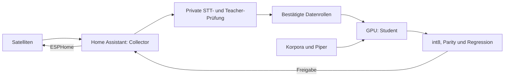

# Wake Word Trainer

Ein öffentlicher Trainer für microWakeWord-Modelle in ESPHome: bestätigte eigene
Aufnahmen, synthetische Sprache und öffentliche Negativkorpora vorbereiten,
auf GPU trainieren und vor dem Modellwechsel mit dem bisherigen Modell
vergleichen. Die Oberfläche ist die öffentliche Home-Assistant-Integration
[Wake Word Collector](https://github.com/ChristophBellmann/ha-wake-word-collector).

[Handbuch](docs/README.md) · [Installation](docs/installation.md) ·
[Home-Assistant-Prüfung](docs/home-assistant-review.md) ·
[GPU-Benchmarks](docs/gpu-training-and-benchmarks.md) ·
[Softwarestack](docs/software-stack-and-compiler.md)



## Hardware und Einrichtung

NVIDIA/CUDA und AMD/ROCm verwenden denselben Trainingscode mit passenden,
getrennt geprüften Framework-Wheels. CPU ist möglich. `training.device: gpu`
verlangt eine echte GPU-Operation; Geräteerkennung allein genügt nicht.
Die [Installation](docs/installation.md) enthält beide GPU-Wege, Framework-
Constraints und Prüfoperatoren. Ein [Stack-Umzug](docs/rocm-update.md) umfasst
Runtime, Compiler, Wheels, Verbraucher und einen privaten Rückweg.

```bash
wake-word-trainer -p my_project init "Hey Nova" --language de
wake-word-trainer -p my_project download --voice de_DE-thorsten-high --data
wake-word-trainer -p my_project run
```

Diese neutralen Beispiele ersetzen keine eigenen bestätigten Mikrofonaufnahmen.
Der [Schnellstart](docs/quick-start.md) erklärt Collector-Token, Stimmen,
positive und negative Phrasen sowie den geprüften Modellwechsel.

## Datenqualität und Fehlaktivierungen

Ungeprüfte Auslösungen werden über den Collector-Token abgerufen und getrennt
von den Trainingsdaten bewertet. Unabhängige STT und ein optionaler Log-Mel-
Teacher ergänzen die Student-Antworten an der Aufnahme. Leere STT ist kein
Beweis für einen Fehlalarm. [Quellenprüfung](docs/data-audit.md) und
[Gesprächsfehlalarme](docs/false-activations-workflow.md) beschreiben den Ablauf.

Öffentliche Sprach-/Hintergrundkorpora und eigene Satelliten-Negative haben
separate Sampling-Anteile. [Negativkorpora](docs/negative-corpora.md) müssen
zum Frontend passen; eine Million Einträge belegt keine Million unabhängiger
Gespräche. [Datenimport](docs/data-import.md) bewahrt Rollen, Herkunft und Hashes.
Prüfclips bleiben aus Optimierer und Mining ausgeschlossen.

## Effizienz und Freigabe

Optimierter Graph-Kern, TFRecord-Pool, Prefetch, CPU-Feature-Worker und begrenzter
Validierungscache lassen sich reproduzierbar vergleichen. Loss, Adam und die
vollständige Bewertung bleiben erhalten. [Benchmarks](docs/gpu-training-and-benchmarks.md)
trennen Input-Wartezeit, GPU-Rechenzeit und End-to-End-Laufzeit. Modellqualität
wird anschließend unabhängig vom Durchsatz verglichen.

Das int8-Modell wird wie auf den Satelliten mit quantisierten Fensterentscheidungen
geprüft. Eine Freigabe verlangt passende Fehlerbudgets und Regression gegen die
Referenz; synthetische Tests allein erlauben keinen automatischen Rollout.
[Bewertung](docs/evaluation.md) und [Rollout](docs/deployment.md) erläutern die Gates.

## Home Assistant und Entwicklung

Der [Dienst](docs/service.md) auf Port 10701 bietet vorkonfigurierte Profile,
Status und private Prüfberichte an. Die Karte kann Aufnahmen prüfen, Training
starten und Ergebnisse anzeigen. [Ressourcen](docs/resources.md) und
[Nachtplanung](docs/automatic-training.md) koordinieren GPU-Verbraucher.
[Extraktion](docs/extraction.md) schneidet mögliche Aufrufe aus langen Aufnahmen.
[Kommandozeile](docs/cli.md) und [HTTP-API](docs/api.md) bilden die Referenz.

Schnelle Tests mit künstlichem Audio und langsame Framework-Prüfungen sind
in [Entwicklung](docs/development.md) dokumentiert. Öffentliche Texte sind
allgemein und auf Deutsch; persönliche Aktivierungswörter, Modelle,
Sprachdaten und Installationshistorien bleiben in privaten Projektordnern.
`projects/` und `downloads/` werden nicht versioniert.

Der Code steht unter Apache-2.0. Datensätze und Stimmen haben eigene
[Lizenzen und Datenschutzregeln](docs/licenses-and-privacy.md).
