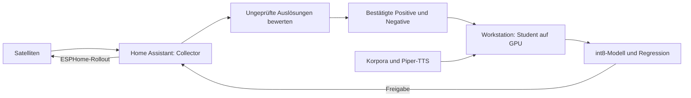

# Wake Word Trainer

Aus eigenen bestätigten Mikrofonaufnahmen, synthetischer Sprache und
öffentlichen Negativkorpora entsteht ein kleines microWakeWord-Modell für
ESPHome. Der Student trainiert mit TensorFlow auf AMD/ROCm oder NVIDIA/CUDA.
Ein optionaler PyTorch-Teacher und unabhängige STT helfen bei der Quellenprüfung.

## Einstieg

[Installation](installation.md) → [Schnellstart](quick-start.md) →
[Konfiguration](configuration.md) → [Trainingsablauf](pipeline.md).
Die [Home-Assistant-Prüfung](home-assistant-review.md) zeigt STT und optionale
Teacher-/Student-Antworten direkt an den Aufnahmen. Labels und Freigaben bleiben
nachvollziehbar; leere STT ist kein Beweis für einen Fehlalarm.

## Qualität und Leistung

[Fehlaktivierungen bei Gesprächen](false-activations-workflow.md),
[Quellen und Teacher prüfen](data-audit.md),
[Negativkorpora](negative-corpora.md) und [Bewertung](evaluation.md) erklären
die getrennten Datenrollen und Qualitätsnachweise.
[GPU-Training und Benchmarks](gpu-training-and-benchmarks.md),
[Softwarestack und Compiler](software-stack-and-compiler.md) sowie
[Runtime-Updates](rocm-update.md) behandeln effiziente und reproduzierbare Ausführung.

## Betrieb

[Trainer-Dienst](service.md), [Ressourcen](resources.md),
[Nachttraining](automatic-training.md), [Clip-Extraktion](extraction.md) und
[Rollout](deployment.md) bilden den HA-Ablauf ab. [Kommandozeile](cli.md)
und [HTTP-API](api.md) enthalten die Referenz.

Private Aktivierungswörter, individuelle Modelle, Sprachaufnahmen und
Installationshistorien gehören in die jeweiligen privaten Projekte.
Die öffentliche Anleitung verwendet neutrale Beispiele.
