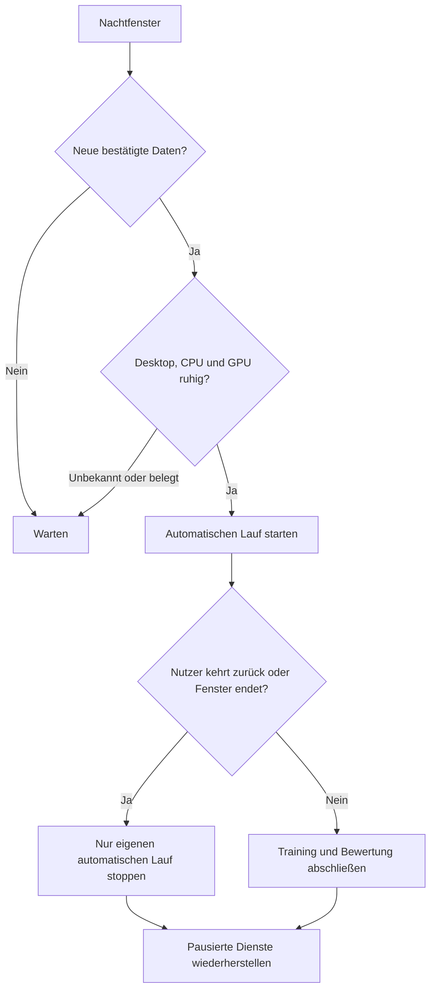

# Training in ruhigen Nachtstunden

Der Trainer-Dienst kann neu freigegebene Positive und Negative während einer
ruhigen Nachtphase automatisch trainieren. Konfiguration bleibt lokal:

```yaml
automatic_training:
  enabled: true
  start: "01:00"
  end: "06:00"
  idle_seconds: 1200
  idle_command: [/path/to/venv/bin/python, -m, wake_word_trainer.idle]
  min_new_samples: 5
  min_interval_hours: 20
  profile: recommended
  max_gpu_use_percent: 5
  max_load_per_cpu: 0.5
  check_seconds: 30
```

Zeiten beziehen sich auf die Workstation. Der erste Abruf bildet die Baseline
der Collector-Hashes. Während eines Laufs neu eintreffende Daten bleiben für
den nächsten Lauf offen. Fehler und Unterbrechungen verbrauchen keine Beispiele;
die Mindestpause verhindert wiederholte Fehlversuche in derselben Nacht.
Nur Trainingsprofile sind erlaubt, keine Prüfung und kein Benchmark.



Die Inaktivitätsprüfung nutzt unter GNOME den Session-D-Bus-Monitor und sonst
unter X11 libX11/libXss. Ein User-Dienst erhält Desktop-Variablen nicht immer;
die Prüfung sucht sie beim systemd-User-Manager, X11-Socket und
`~/.Xauthority`. Wayland fällt nicht auf XWayland zurück, das native Eingaben
nicht vollständig sieht. Bei anderen Desktops einen Befehl konfigurieren,
der echte Inaktivitätssekunden liefert. Fehlende oder ungültige Messungen
blockieren die Automatik und erscheinen als Fehler im Status.

Kehrt der Nutzer zurück, stoppt nur der von dieser Planung gestartete Lauf.
Manuelle Läufe bleiben erhalten. Ein Firmware-Rollout blockiert einen neuen
Start. Auch automatisch trainierte Modelle müssen Regression und Parity
bestehen; neue Negativbeispiele garantieren keine Verbesserung.

Ungeprüfte Auslösungen werden zuerst über die [HA-Prüfung](home-assistant-review.md)
klassifiziert und bestätigt. Die optionale Collector-Funktion für Auslösungen
mit bestätigtem leerem Assist-STT bleibt eine getrennte, bewusst aktivierbare
Quelle; technische Fehler liefern keine negativen Trainingslabels.
