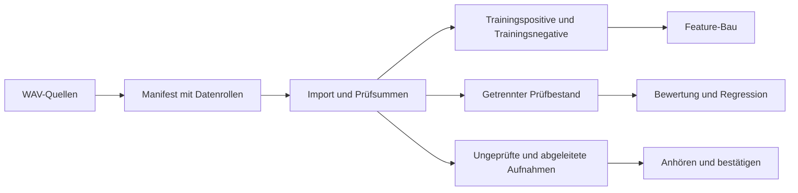

# Daten mit Herkunft und getrennten Rollen übernehmen

Vorhandene WAV-Quellen können in ein eigenes Projekt importiert werden.
Trainings- und Prüfaufnahmen erhalten dabei ausdrückliche Rollen. Ein
Ordnername allein ist kein Label; ungeprüfte Clips bleiben außerhalb des
Trainings. Originalquellen und Inhalts-Hashes bleiben nachvollziehbar.



## Import

```yaml
# sources.yaml; Pfade sind relativ zu dieser Datei oder absolut.
sources:
  - {folder: sources/approved/train, role: train_positive}
  - {folder: sources/approved/eval, role: eval_positive}
  - {folder: sources/confirmed_false_activations, role: train_negative}
  - {folder: sources/negative_holdout, role: eval_negative}
  - {folder: sources/tts_negative, role: synthetic_negative}
  - {folder: sources/voxpopuli_de, role: speech}
  - {folder: sources/audioset, role: negative_background}
  - {folder: sources/ambient, role: background}
  - {folder: sources/rirs, role: rir}
  - {folder: sources/pending, role: unlabelled}
  - {folder: sources/augmented_positive, role: derived_positive}
```

```bash
wake-word-trainer -p my_project init "Hey Nova" --language de
wake-word-trainer -p my_project data import sources.yaml --dry-run
wake-word-trainer -p my_project data import sources.yaml
wake-word-trainer -p my_project data check
```

Weitere Rollen sind `hard_positive` und `synthetic_positive`. Unbeschriftete
Aufnahmen liegen unter `review/unlabelled`, abgeleitete Positive unter
`archive/derived_positive`. Beide gelangen nicht in Trainingsfeatures.
Der Import kopiert Original-WAVs; Mono-Mischung und Resampling auf 16 kHz
erfolgen beim Audio-Lesen. Er regeneriert keine alten MMAPs oder Modelle und
übernimmt keine Secrets. `dataset-import.jsonl` erhält die Quellpfade und
Hashes. `dataset-manifest.jsonl` und `dataset-check.json` dokumentieren den
aktuellen Bestand und seinen Inhalts-Fingerprint.
Unveränderte Hashes werden nur bei identischer Größe, Änderungs-/Statuszeit,
Inode und Gerät wiederverwendet. `data check --rehash` liest alle Inhalte erneut.

Importierte Aufnahmen bleiben beim `fetch` erhalten. Änderungen an deren
Labels müssen daher im importierten Bestand und dessen Herkunftsmanifest
bewusst gepflegt werden; eine Ablehnung im Collector entfernt nur die
Collector-Kopie. Für einen Vergleich ein eigenes, eingefrorenes Projekt ohne
Collector verwenden.

## Belegte Aufnahmegruppen erhalten

Jede Quelle darf zusätzlich `parent_recording_id`, `session_id`, `speaker_id`
und `capture_generation` enthalten. Nur nachgewiesene Angaben verwenden;
weglassen oder `null` bedeutet unbekannt. Leere oder nicht als Zeichenkette
angegebene IDs werden abgelehnt. Die Angaben gelten für **alle** WAVs dieses
Quellordners; unterschiedlich zugeordnete Aufnahmen benötigen getrennte
Quellen. Zeitnähe, Dateinamen und Modellvorhersagen begründen keine Identität.

```yaml
sources:
  - folder: sources/confirmed_session_a
    role: train_positive
    parent_recording_id: corpus_a/recording_17
    session_id: corpus_a/session_3
    speaker_id: corpus_a/speaker_2
    capture_generation: microphone_pipeline_v2
```

Die IDs müssen innerhalb des Projekts eindeutig benannte, wiederverwendbare
Gruppen bezeichnen. Ein Korpuspräfix verhindert zufällige Namenskollisionen.
Wenn Sprecher über mehrere Korpora nachweislich identisch sind, dieselbe
Sprecher-ID verwenden. Private Identitäten und Aufnahmeprovenienz bleiben im
privaten Projekt, nicht in öffentlichen Beispielen oder Repositories.

Der bestehende `dataset-import.jsonl`-Vertrag übernimmt die vier optionalen
Felder pro Aufnahme. Die Inventur bindet sie an Zielpfad **und** Audiohash und
übernimmt sie in `dataset-manifest.jsonl`, auch bei gecachten Prüfsummen oder
`--rehash`. Ergänzte Angaben werden erneut geprüft; widersprüchliche Angaben
werden nicht still überschrieben. Ein veränderter Audioinhalt erbt keine
Herkunft des früheren Inhalts. Vorhandene Dateien werden weder umsortiert noch
umetikettiert.

Import (auch `--dry-run`) und Preflight verweigern gemeinsame bekannte
`parent_recording_id`-, `session_id`- oder `speaker_id`-Gruppen in Training und
Bewertung, selbst wenn die Audiohashs verschieden sind. Schwierige Positive,
synthetische Daten und zusätzliche negative Sprach-/Hintergrundkorpora zählen
zur Trainingsseite. Unbeschriftete/archivierte Aufnahmen, RIRs und reine
Augmentationshintergründe sind von dieser Rollenprüfung ausgenommen.
`capture_generation` dokumentiert die Audiostrecke, beispielsweise einen
bestätigten Mikrofonkanal-/Gainwechsel. Die gleiche Audiostrecke allein ist
keine Aufnahme- oder Sprecherüberschneidung.

`dataset-check.json` enthält zusätzlich `provenance` mit fehlenden Angaben je
Feld und folgenden Zuständen:

| Zustand | Bedeutung |
| --- | --- |
| `unknown` | Keine Herkunftsangaben zu den aktiven Dateien vorhanden. |
| `incomplete` | Angaben fehlen oder eine der beiden Rollen Training/Bewertung fehlt. |
| `conflict` | Die Datenprüfung hat einen Konflikt erkannt; Preflight bricht ab. |
| `known_groups_disjoint` | Alle vier Angaben sind vorhanden und bekannte Gruppen überschneiden sich nicht zwischen Training und Bewertung. |

Altdaten ohne Angaben bleiben verwendbar, werden aber ausdrücklich als
unvollständig/unbekannt berichtet. `issues: []` allein belegt keine unabhängige
Provenienz. Auch vollständige Metadaten bestätigen weder die Richtigkeit der
angegebenen Identitäten noch einen bisher unbenutzten Abnahmetest. Der Trainer
identifiziert keine Sprecher und erzeugt keine Sitzungsgruppen automatisch.

## Reproduzierbare Vergleiche

`experiment prepare` erstellt isolierte Projekte für wiederholte Seed-Läufe.
Die freigegebenen WAVs und vorhandenen TTS-Clips werden eingefroren; externe
Korpora bleiben gemeinsame unveränderte Quellen. Live-Sync und Sprach-
Neugenerierung sind dort aus, der Rollout ist deaktiviert.

```bash
wake-word-trainer -p my_project experiment prepare --seed 1337 --seed 1338
wake-word-trainer -p my_project --downloads shared_downloads experiment run
```

Ein Seed belegt keine Verbesserung. Dasselbe Audio, dieselbe quantisierte
Satellitenlogik und gemeinsam festgelegte Fehlerbudgets verwenden. Ein für
Checkpoint-Auswahl verwendeter Holdout ist kein unabhängiger Abschlusstest.
[Quellenprüfung](data-audit.md) und [Bewertung](evaluation.md) erklären die
Kontrollen vor einer Freigabe.
