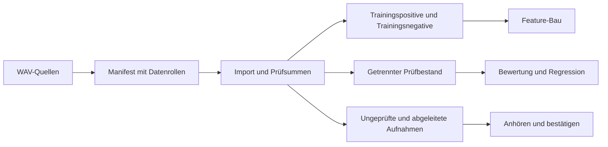

# Daten mit Herkunft und getrennten Rollen übernehmen

Vorhandene WAV-Quellen können in ein eigenes Projekt importiert werden.
Trainings- und Prüfaufnahmen erhalten dabei ausdrückliche Rollen. Ein
Ordnername allein ist kein Label; ungeprüfte Clips bleiben außerhalb des
Trainings. Originalquellen und Inhalts-Hashes bleiben nachvollziehbar.



## Import

```yaml
# sources.yaml; Pfade sind relativ zu dieser Datei oder absolut.
sources:
  - {folder: sources/approved/train, role: train_positive}
  - {folder: sources/approved/eval, role: eval_positive}
  - {folder: sources/confirmed_false_activations, role: train_negative}
  - {folder: sources/negative_holdout, role: eval_negative}
  - {folder: sources/tts_negative, role: synthetic_negative}
  - {folder: sources/voxpopuli_de, role: speech}
  - {folder: sources/audioset, role: negative_background}
  - {folder: sources/ambient, role: background}
  - {folder: sources/rirs, role: rir}
  - {folder: sources/pending, role: unlabelled}
  - {folder: sources/augmented_positive, role: derived_positive}
```

```bash
wake-word-trainer -p my_project init "Hey Nova" --language de
wake-word-trainer -p my_project data import sources.yaml --dry-run
wake-word-trainer -p my_project data import sources.yaml
wake-word-trainer -p my_project data check
```

Weitere Rollen sind `hard_positive` und `synthetic_positive`. Unbeschriftete
Aufnahmen liegen unter `review/unlabelled`, abgeleitete Positive unter
`archive/derived_positive`. Beide gelangen nicht in Trainingsfeatures.
Der Import kopiert Original-WAVs; Mono-Mischung und Resampling auf 16 kHz
erfolgen beim Audio-Lesen. Er regeneriert keine alten MMAPs oder Modelle und
übernimmt keine Secrets. `dataset-import.jsonl` erhält die Quellpfade und
Hashes. `dataset-manifest.jsonl` und `dataset-check.json` dokumentieren den
aktuellen Bestand und seinen Inhalts-Fingerprint.
Unveränderte Hashes werden nur bei identischer Größe, Änderungs-/Statuszeit,
Inode und Gerät wiederverwendet. `data check --rehash` liest alle Inhalte erneut.

Importierte Aufnahmen bleiben beim `fetch` erhalten. Änderungen an deren
Labels müssen daher im importierten Bestand und dessen Herkunftsmanifest
bewusst gepflegt werden; eine Ablehnung im Collector entfernt nur die
Collector-Kopie. Für einen Vergleich ein eigenes, eingefrorenes Projekt ohne
Collector verwenden.

## Reproduzierbare Vergleiche

`experiment prepare` erstellt isolierte Projekte für wiederholte Seed-Läufe.
Die freigegebenen WAVs und vorhandenen TTS-Clips werden eingefroren; externe
Korpora bleiben gemeinsame unveränderte Quellen. Live-Sync und Sprach-
Neugenerierung sind dort aus, der Rollout ist deaktiviert.

```bash
wake-word-trainer -p my_project experiment prepare --seed 1337 --seed 1338
wake-word-trainer -p my_project --downloads shared_downloads experiment run
```

Ein Seed belegt keine Verbesserung. Dasselbe Audio, dieselbe quantisierte
Satellitenlogik und gemeinsam festgelegte Fehlerbudgets verwenden. Ein für
Checkpoint-Auswahl verwendeter Holdout ist kein unabhängiger Abschlusstest.
[Quellenprüfung](data-audit.md) und [Bewertung](evaluation.md) erklären die
Kontrollen vor einer Freigabe.
