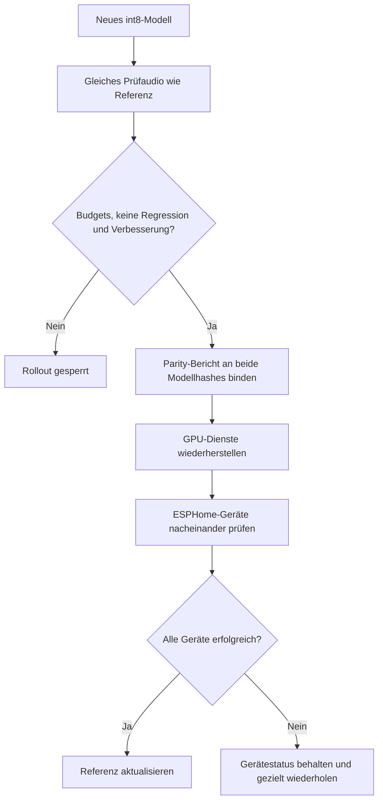

# Automatischer Firmware-Rollout

Ein Trainingsabschluss allein aktualisiert keinen Satelliten. Der übliche
HA-Weg ist der Rollout der öffentlichen Collector-Integration über ESPHome.
Alternativ kann der Trainer einen lokal konfigurierten Befehl ausführen:

```yaml
deployment:
  enabled: true
  reference_model: deployed/model.tflite
  command: [python3, /path/to/model_update.py, --config, /path/to/wake-word-model.yaml,
            --expected-sha256, "{sha256}", --wait, "120", --build]
```

Das eingesetzte TFLite-Modell **und dessen Manifest** als Referenz hinterlegen.
Pfade, Zugangsdaten und Flash-Befehle bleiben privat; HTTP-Aufrufer können sie
nicht setzen. Der Modell-Updater muss jedes gewünschte Gerät prüfen und bei
jedem Fehler einen Fehlerstatus zurückgeben. Parity-Prüfung und ein Modellname
mit Hash binden die Freigabe an genau diese Datei.



Erkennungsrate, eigene Negative, Satelliten-Negative und Ambient-Budgets müssen
passen; mindestens eine echte Verbesserung ist erforderlich. Synthetische
Prüfung allein erlaubt keinen automatischen Rollout. Prüfprofile und Benchmarks
bieten kein Modell an und starten keinen Rollout.

Nach Training werden pausierte GPU-Dienste wiederhergestellt. Erst dann folgt
der Befehl. `deployment.json`, `parity.json`, `deployment.log` und der Status
halten den Stand getrennt vom Training fest. Die Referenz wird erst nach Erfolg
aller Geräte weitergesetzt. `deploy` wiederholt, `deploy --compare` bewertet
einen vorhandenen Export vorher neu. Der Collector-Updater überspringt beim
Wiederholen bereits erfolgreiche Geräte.
