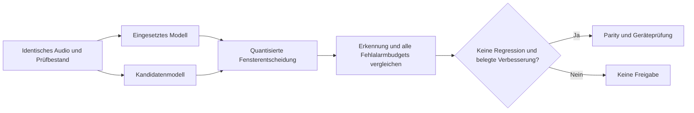

# Bewertung und Schwelle

`evaluate` prüft das exportierte Modell mit streaming-int8-Inferenz und dem
konfigurierten gleitenden Fenster, entsprechend der Satellitenlogik. Alle 256
darstellbaren 8-Bit-Schwellen werden verglichen.

| Messgröße | Aussage |
| --- | --- |
| Erkennungsrate | erkannte eigene Prüfpositive / alle eigenen Prüfpositive |
| Fehlaktivierungen pro Stunde | Fehler auf vollständig geprüftem Ambient-Audio / Audio-Stunden |
| Eigene Negativfehler | ausgelöste eigene Prüfclips ohne Aktivierungswort |
| Satelliten-Negativfehler | Teilmenge tatsächlicher Fehlalarmclips vom Collector |

## Skalierung und exakte Entscheidung

Unskalierte `uint16`-Microfrontend-MMAPs müssen ihren Datentyp bis zur Inferenz
behalten, damit die Skalierung mit `0.0390625` angewendet wird. Schon skalierte
Float-Features dürfen nicht nochmals skaliert werden. Roh-MMAP und passend
skalierte Float-Fassung werden durch Regressionstests gegeneinander geprüft.

Bei int8-Modellen werden die ursprünglichen 8-Bit-Ausgaben ganzzahlig summiert.
Die Entscheidung vergleicht Summe mit Schwelle × Fenstergröße entsprechend
[ESPHome](https://github.com/esphome/esphome/blob/dev/esphome/components/micro_wake_word/streaming_model.cpp).
So entstehen an exakten Grenzen keine numerischen Überschreitungen oberhalb
von 1,0. Float-Modelle behalten Float-Ausgaben. Audit und Mining benutzen für
quantisierte Students denselben Entscheidungspfad.

## Schwelle wählen

Der Trainer wählt die empfindlichste darstellbare Schwelle innerhalb von
`evaluation.max_false_accepts_per_hour`, `evaluation.max_own_negative_share`
und oberhalb von `evaluation.min_probability_cutoff`. Sie wird als
`probability_cutoff` im ESPHome-Manifest gespeichert. Eine höhere Schwelle
kann Fehlalarme reduzieren und gleichzeitig echte Aufrufe verlieren.

`report.json` enthält die ganze Kurve, verpasste Positive und ausgelöste
Negative. Auffällige Aufnahmen anhören, Herkunft und Label prüfen; schlecht
erkannte echte Aufrufe dürfen nicht nur zur Verbesserung der Zahl entfernt
werden. Ein zur Checkpoint-Auswahl verwendeter Bestand ist keine unabhängige
abschließende Prüfung.

Ohne eigene Aufnahmen kann synthetische Sprache eine Funktion prüfen. Sie
belegt keine Erkennung realer Mikrofonaufnahmen und gibt keinen automatischen
Rollout frei. Wenige fehlerfreie Audio-Stunden belegen ebenfalls keine
Nullfehlerrate im Alltag.
