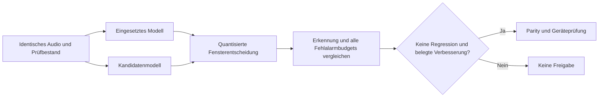

# Bewertung und Schwelle

`evaluate` prüft das exportierte Modell mit Streaming-Inferenz und dem
konfigurierten gleitenden Fenster. Alle 256 darstellbaren 8-Bit-Schwellen
werden verglichen. Die Ereigniszählung für kontinuierlichen Hintergrund und
die Peak-Diagnose einzelner Prüfclips sind unterschiedliche Messungen.

| Messgröße | Aussage |
| --- | --- |
| Erkennungsrate | erkannte eigene Prüfpositive / alle eigenen Prüfpositive |
| Fehlaktivierungen pro Stunde | simulierte Ereignisse auf Ambient-Features / Feature-Stunden |
| Eigene Negativfehler | ausgelöste eigene Prüfclips ohne Aktivierungswort |
| Satelliten-Negativfehler | Teilmenge tatsächlicher Fehlalarmclips vom Collector |

## Skalierung und exakte Entscheidung

Unskalierte `uint16`-Microfrontend-MMAPs müssen ihren Datentyp bis zur Inferenz
behalten, damit die Skalierung mit `0.0390625` angewendet wird. Schon skalierte
Float-Features dürfen nicht nochmals skaliert werden. Roh-MMAP und passend
skalierte Float-Fassung werden durch Regressionstests gegeneinander geprüft.

Bei int8-Modellen werden die ursprünglichen 8-Bit-Ausgaben ganzzahlig summiert.
Die Entscheidung vergleicht Summe mit Schwelle × Fenstergröße entsprechend
[ESPHome 2026.9.1](https://github.com/esphome/esphome/blob/2026.9.1/esphome/components/micro_wake_word/streaming_model.cpp).
So entstehen an exakten Grenzen keine numerischen Überschreitungen oberhalb
von 1,0. Float-Modelle behalten Float-Ausgaben. Audit und Mining benutzen für
quantisierte Students denselben Entscheidungspfad.

## Ereigniszählung auf kontinuierlichem Hintergrund

Die Policy `esphome-2026.9.1-continuous-v1` bildet den aktivierten
Wakeword-Ereignisautomaten dieser Version nach: Anfangs ist das Fenster mit
Nullen gefüllt. Erst nach 100 Feature-Schritten mit aktuellem Wert **unter**
der Schwelle darf ein Treffer auftreten. Diese Schritte müssen nicht
aufeinanderfolgen. Die Fenstersumme muss die Schwelle mal Fenstergröße
**überschreiten**; Gleichheit reicht weder zum Auslösen noch zum Wiederfreigeben.
Nach einem Treffer wird das Fenster geleert und die Wiederfreigabe beginnt neu.

Gezählt werden Feature-Schritte, auch zwischen Modellaufrufen. Dort gilt der
zuletzt gespeicherte Wert, nach einem Reset zunächst null. Ein noch gesperrtes
Ergebnis kann deshalb zwischen zwei Modellaufrufen freigegeben werden. Jeder
Ambient-Track startet mit einem neuen Ereigniszähler. Der Nenner enthält alle
zugehörigen Feature-Schritte einschließlich Anlauf, Wiederfreigabe und Rest
ohne neuen Modellaufruf; das gleitende Fenster verkürzt ihn nicht mehr.

`report.json` benennt unter `ambient_event_counting` Policy, Quantisierung,
Stride, Feature-Schrittweite und Annahmen. Der simulierte Detektor hört
kontinuierlich, der VAD ist immer offen, `stop_after_detection` ist aus.
Geräteseitige VAD-Sperren, Assistenzsitzungen, Stop-/Restartzeiten und
Ausfälle benötigen eigene Ereignisspuren. Feature-Dauer ist keine gemessene
Gerätebetriebszeit. Floatmodelle verwenden dieselben Zustandsregeln ohne
Requantisierung als Diagnose; sie belegen keine int8-Geräteparität.

**Frühere FA/h-Berichte sind nicht unmittelbar vergleichbar:** Sie zählten
auf bereits gemittelten Scores mit einer festen Sperrzeit von 0,75 s und
verkürzten die Messdauer um den Fensteranlauf. Ein langes Hochplateau konnte
dadurch wiederholt auslösen. Fehlende oder leere `ambient_event_counting`
bedeutet keinen Nachweis der neuen Semantik. Alte Berichte bleiben unverändert.

Diese Korrektur ist noch keine vollständige Geräteabnahme: Frontend,
Quantisierung und Interpreterzustand müssen separat verglichen werden.
Recall und eigene Negativfehler bleiben Peak-Messungen auf Clips mit
zusätzlicher Stille, ohne den Ereignisautomaten. Insbesondere kann bei
Schwelle null der Ereignisautomat nie freigegeben werden, obwohl Clip-Peaks
positiv sind. Die neue Auswertung schließt null deshalb bei der automatischen
Schwellenwahl aus. Die Schwellenwahl allein rechtfertigt keinen Rollout.
Neue Qualitätsfreigaben erfordern eine unabhängige Prüfung von kontinuierlicher
Negativsprache, echten Wakewords und tatsächlichem Gerätebetriebspunkt.

## Schwelle wählen

Der Trainer wählt die empfindlichste darstellbare Schwelle innerhalb von
`evaluation.max_false_accepts_per_hour`, `evaluation.max_own_negative_share`
und oberhalb von `evaluation.min_probability_cutoff`. Sie wird als
`probability_cutoff` im ESPHome-Manifest gespeichert. Eine höhere Schwelle
kann Fehlalarme reduzieren und gleichzeitig echte Aufrufe verlieren.

`report.json` enthält die ganze Kurve, verpasste Positive und ausgelöste
Negative. Auffällige Aufnahmen anhören, Herkunft und Label prüfen; schlecht
erkannte echte Aufrufe dürfen nicht nur zur Verbesserung der Zahl entfernt
werden. Ein zur Checkpoint-Auswahl verwendeter Bestand ist keine unabhängige
abschließende Prüfung.

Ohne eigene Aufnahmen kann synthetische Sprache eine Funktion prüfen. Sie
belegt keine Erkennung realer Mikrofonaufnahmen und gibt keinen automatischen
Rollout frei. Wenige fehlerfreie Audio-Stunden belegen ebenfalls keine
Nullfehlerrate im Alltag.
