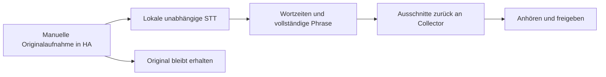

# Clips aus langen Aufnahmen ausschneiden

Das Extra `segment` installiert faster-whisper. In der vorhandenen geprüften
Umgebung mit deren Framework-Constraints installieren und lokal freigeben:

```yaml
extraction:
  enabled: true
  model: small
  cpu_threads: 4
  padding_ms: 200
  min_probability: 0.35
  silence_ms: 500
```

Der Collector sendet eine manuelle WAV-Aufnahme an das authentifizierte
`POST /v1/extract`; `X-Wakeword-Phrases` enthält die konfigurierte Phrase und
Varianten als JSON-Liste. CPU-/int8-STT liefert Wortzeiten und vollständige
passende Phrasen mit begrenztem Kontext. Das Modell sollte `alignment_heads`
enthalten, wie die normale aktuelle Konvertierung von `small`.



Audio wird auf der Workstation im Speicher verarbeitet und für diese Extraktion
nicht abgelegt oder an eine Cloud gesendet. Der Trainer importiert die
Ausschnitte nicht selbst in das Training. Der Collector behält das Original
und zeigt Ausschnitte zur Prüfung an.

Erlaubt sind höchstens 4 MiB, 0,5–120 Sekunden, mono PCM16 und 16/48 kHz.
Die Projekt-Sprache wählt die Erkennungssprache. `silence_ms` trennt Regionen,
sodass wiederholte identische Phrasen nicht zu einem einzigen Text kollabieren.
Etwa eine Sekunde Pause zwischen Aufrufen hilft beim Schneiden.

Extraktion läuft seriell auf CPU ohne Pausieren von GPU-Diensten und unabhängig
vom Wakeword-Modell. Schwierige Aussprachen können trotzdem fehlen; Varianten,
Anhören und manuelles Schneiden bleiben nötig. `/v1/status.extraction` zeigt
Freigabe und Verfügbarkeit.
