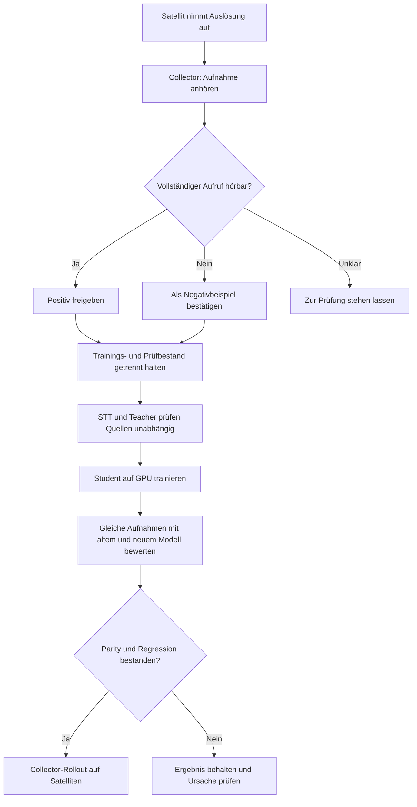

# Fehlaktivierungen beim Telefonieren verringern

Das Ziel ist ein Modell, das Gespräche ignoriert und den vollständigen Aufruf
„Hey Momo“ weiter erkennt. Dafür braucht es bestätigte Gesprächsbeispiele,
einen getrennten Prüfbestand und einen Vergleich mit dem eingesetzten Modell.
Mehr Training oder ein höherer Schwellwert allein garantiert das nicht.



## 1. Die Sammlung in Home Assistant nutzen

Der öffentliche [Wake Word Collector](https://github.com/ChristophBellmann/ha-wake-word-collector)
ist die Quelle der Satellitenaufnahmen. Eine Auslösung während eines Telefonats
ist zunächst ein Prüfclip. Wenn kein vollständiges Aktivierungswort hörbar ist,
wird sie nach dem Anhören negativ freigegeben. Enthält das Gespräch tatsächlich
„Hey Momo“, gehört es nicht als Negativbeispiel ins Training.

Gerät, Mikrofonpfad und Aufnahmedatum helfen, Fehler einzugrenzen. Ein veränderter
Mikrofonkanal oder Filter kann STT verschlechtern. Eine leere Transkription
bedeutet deshalb nicht, dass der Clip ein bestätigter Fehlalarm ist.

Allein gesprochenes „Momo“ bleibt bei einem Zweiwort-Modell negativ. Einige
späte Lab-Experimente haben diese Semantik geändert; sie werden nicht allein
wegen ihres Branchnamens übernommen.

Die [Prüfung direkt in Home Assistant](home-assistant-review.md) ruft diese
ungeprüften Clips mit dem Collector-Token ab und zeigt STT-/Modell-Ergebnisse
in der Karte. Die Bestätigung bleibt beim Menschen.

## 2. Quellen und Beschriftungen unabhängig prüfen

```bash
wake-word-trainer -p hey_momo fetch
wake-word-trainer -p hey_momo data check
wake-word-trainer -p hey_momo audit --stt-model small \
  --model deployed/hey_momo.tflite --teacher teacher/legacy.pt \
  --unlabelled-folder review/unlabelled --output audit/current
```

Der letzte Befehl setzt ein separat importiertes Teacher-Modell und eine Kopie
des eingesetzten TFLite-Modells voraus. Beide Optionen lassen sich weglassen.
Widersprüche zwischen Beschriftung, STT und Wakeword-Modellen werden zum Anhören
markiert. Die Prüfung ändert keine Labels. Ein größeres STT-Modell kann auf
auffällige Clips beschränkt werden; die Berichte bleiben privat.

Der Teacher verwendet Log-Mel-Features, der Student ESPHome-Microfrontend-
Features. Ein importierter Teacher muss auf heutigen Mikrofonaufnahmen geprüft
werden. Erst ein nachweislich hilfreicher Teacher eignet sich als zusätzliche
Prüfstimme. Seine Scores sind keine automatisch freigegebenen Trainingslabels.
Siehe [Quellenprüfung und Teacher](data-audit.md).

## 3. Einen reproduzierbaren GPU-Vergleich vorbereiten

Bestätigte negative Satellitenaufnahmen erhalten einen eigenen Sampling-Anteil.
So verdünnen große öffentliche Sprachkorpora die wenigen realen Fehlalarme nicht.
Deutschsprachige Gespräche, ähnliche Wörter, Hintergrundgeräusche und eigene
Positive erfüllen unterschiedliche Rollen; ihre Herkunft bleibt erhalten.

Für einen Modellvergleich wird der Bestand eingefroren. Prüfaufnahmen dürfen
weder ins Training noch ins Mining zurückgelangen. Unterschiedliche Seeds
erhalten eigene Projektordner. Das kurze Lab-Profil mit vollständiger Bewertung,
Lernratenabfall und Frühstopp ist ein sinnvoller Gegenversuch. Automatisches
Mining bleibt dabei aus: Spätere Lab-Kampagnen verschlechterten das Modell.

Die [Übernahmeliste](migration-from-wakeword-lab.md) zeigt, welche bewährten
Teile wieder verfügbar sind und welche Experimente bewusst nicht aktiviert
wurden. [GPU-Training und Benchmarks](gpu-training-and-benchmarks.md) erklärt
die Geräteauswahl, CPU-Phasen, Messmethodik und gemessenen Leistungsgewinne.

## 4. Erkennung und Fehlalarme gemeinsam vergleichen

Der int8-TFLite-Vergleich benutzt für beide Modelle dasselbe Audio und dieselbe
Satellitenlogik. Der Bericht enthält Erkennungsrate, Fehlaktivierungen pro
Stunde Hintergrundaudio sowie ausgelöste eigene und Satelliten-Negative.
Schwellwerte werden auf den tatsächlich darstellbaren 8-Bit-Stufen geprüft.

Eine kleine Handvoll Telefonclips ersetzt keine längere Gesprächsaufnahme.
Ebenso belegt null Fehler auf einigen Stunden Audio noch keine Nullfehlerrate
im Alltag. Für den Entscheid bleiben der gemeinsame Prüfbestand, die
getrennten Satellitenzahlen und anschließend neue reale Aufnahmen maßgeblich.
Ein zur Auswahl von Checkpoints verwendeter Holdout ist kein unabhängiger
abschließender Test; die Zahlen müssen entsprechend eingeordnet werden.

## 5. Erst nach bestandenem Vergleich ausrollen

Der Trainer kann einen schnellen Benchmark erfolgreich abschließen, ohne ein
Modell auszurollen. Auch ein fertig trainiertes Modell bleibt bei fehlgeschlagener
Parity oder verschlechterten Satelliten-Negativen gesperrt. Der normale Rollout
erfolgt über die Collector-Integration und den ESPHome Device Builder.
Siehe [Bewertung](evaluation.md) und [Ausrollen](deployment.md).

Nach einem Rollout werden neue Auslösungen weiter gesammelt. Sie bilden den
frischen Nachweis, ob Telefonate seltener aufwecken und echte Aufrufe erhalten
bleiben. Audio, Transkripte, Teacher-Gewichte und persönliche Prüfberichte
gehören in private Projektordner, nicht ins öffentliche Repository.
