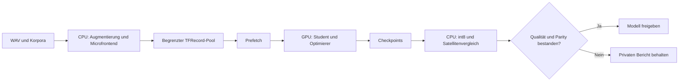

# GPU-Training und reproduzierbare Benchmarks

[Softwarestack, Compiler und Optimierung](software-stack-and-compiler.md)
erklärt die beteiligte ML-Software und unterscheidet Framework-Neubau,
Graph-Ausführung, GPU-Kernels und Modellqualität.

Der [ROCm-/MIOpen-Vergleich](rocm-update.md) dokumentiert den separat geprüften
neuen AMD-Stack, den Teacher-Durchsatz und die Vorbereitung eines Systemumzugs.

Der Student trainiert mit TensorFlow auf CUDA oder ROCm, der optionale Teacher
mit PyTorch auf CUDA/ROCm. `training.device: gpu` verlangt eine tatsächlich
verfügbare GPU; ein fehlender Treiber oder CPU-Wheel führt zum Abbruch. `auto`
bevorzugt eine verfügbare GPU, `cpu` erzwingt CPU. Ein kleiner abgeschlossener
GPU-Rechenschritt dokumentiert das verwendete Gerät in `training_runtime.json`.
Das Erkennen eines Geräts allein gilt nicht als Ausführungsnachweis.

Audio-Augmentation, Microfrontend-Feature-Bau und das lokale faster-whisper
arbeiten weiter auf CPU. Der int8-TFLite-Vergleich arbeitet ebenfalls auf CPU,
weil er den Satellitenpfad prüft. Eine ruhende GPU in diesen Phasen bedeutet
deshalb nicht, dass das anschließende Training auf CPU läuft.

## Die GPU gleichmäßig versorgen

Die Eingangsleitung und der Trainingskern werden getrennt verglichen.
TFRecords bleiben auf Datenträger; Shuffle, Prefetch und der Cache des
Prüfbestands haben feste Grenzen. Augmentierung wird je Batch neu gezogen,
und die vollständige Validierung bleibt erhalten. Größere Batches werden
sowohl nach Schritten/s als auch Beispielen/s und danach nach Qualität bewertet.



## Optimiertes Training konfigurieren

```yaml
training:
  device: gpu
  engine: optimized                 # standard bleibt zum Gegenvergleich verfügbar
  input_pipeline: tfrecord          # alternativ prefetch oder python
  tfrecord_examples: 65536
  input_threads: 4
  feature_workers: 4                # CPU-Aufbereitung; Standard 1
  compute_threads: 4
  prefetch_batches: 2
  batch_size: 256
  validation_batch_size: 1024
  validation_cache_mb: 4096          # nur bei ausreichend freiem RAM wählen
  progress_interval: 25
```

Öffentliche Defaults: `device: auto`, `engine: standard`, Zuführung `prefetch`,
je vier Threads, zwei Prefetch-Batches und 512 MiB Validierungs-Cache. Die
Zuführungseinstellungen werden vom optimierten Kern verwendet. So bleibt der
bisherige Weg als Referenz verfügbar.

Der neue Kern erhält den bisherigen gewichteten Keras-Loss, Adam und die
Checkpoint-Auswahl. Er aktiviert weder Soft-Label-Distillation noch die
abweichende Loss-Normalisierung anderer Trainingskerne. Zeit- und Frequenzmasken
werden für jeden Batch neu auf GPU erzeugt, nach dem statischen Input-Cache.
Die Validierung verarbeitet sämtliche bisherigen Clips und Ambient-Fenster.
Cache-Grenze und RAM-Reserve verhindern ein unbeschränktes Vorladen.

TFRecord-Stamps binden Feature-Dateien, Metadaten, Form, Sampling-/Penalty-
Gewichte, Trunkierungsregeln und Seed. Neue Features oder andere Quellen
erzeugen einen anderen Cache. Batchgrößen dürfen denselben unveränderten Pool
verwenden. Ein Benchmark misst also nicht unbemerkt einen alten Trainingspool.

## Messen

Zuerst vorhandene Features vorbereiten, dann vergleichen:

```bash
wake-word-trainer -p my_project run --prepare-only
wake-word-trainer -p my_project benchmark --device gpu \
  --engine standard --engine optimized --pipeline prefetch \
  --batch-size 256 --warmup 25 --steps 200 --repeats 2 \
  --validation-cache-mb 4096 --output benchmarks/engine_comparison

wake-word-trainer -p my_project benchmark --engine optimized \
  --pipeline prefetch --pipeline tfrecord \
  --batch-size 128 --batch-size 256 --batch-size 512 --batch-size 1024 \
  --warmup 25 --steps 200 --repeats 2 \
  --validation-cache-mb 4096 --output benchmarks/batch_comparison
```

Jede Variante erhält einen frischen Framework-Prozess und ein eigenes
Modellverzeichnis. Seed, Modellprofil und Quellen bleiben gleich; der zweite
Durchgang dreht die Variantenreihenfolge um. GPU-Rechenarbeit wird vor der
Zeitnahme abgeschlossen, Aufwärmschritte sind getrennt. Die Berichte enthalten
Vorbereitung, Input-Wartezeit, Rechenzeit, Schritte/s, Beispiele/s, GPU-Last,
VRAM, GPU-Leistung sowie kalte und warme Validierung. Unterschiedliche
Loss-Logwerte der zwei Kerne sind gekennzeichnet: Der alte Weg meldet eine
ungewichtete laufende Metrik, der neue den gewichteten Batch-Loss.

`README.md`, `summary.json`, `results.json` und die Einzelberichte liegen im
privaten Ausgabeordner. Ein vorhandener Ausgabeordner wird nicht überschrieben.
Ein fehlgeschlagener Lauf zählt nicht als schneller Lauf. Der Benchmark
verändert keine Labels, Projektgewichte oder ESPHome-Exporte und löst keinen
Rollout aus. Ein Durchsatzgewinn belegt noch keinen Qualitätsgewinn.

Die zugrunde liegenden Verfahren sind in den offiziellen Anleitungen zu
[TensorFlow-Input-Pipelines](https://www.tensorflow.org/guide/data_performance)
und [PyTorch-Benchmarks](https://docs.pytorch.org/tutorials/recipes/recipes/benchmark.html)
beschrieben: Datenzuführung überlappen, Cache-Größe beachten, GPU-Arbeit vor
der Zeitnahme synchronisieren und Aufwärmzeit getrennt behandeln.

## Messung auf RX 6700 XT

Am 13.10.2026: ROCm-TensorFlow 2.20, echte vorhandene Mikrofon-, TTS-, Sprach-
und Hintergrundfeatures, Profil `current_wider`, Seed 42, je 25 Aufwärm- und
200 Messschritte, zwei Wiederholungen. Medianwerte:

| Kern / Zuführung | Batch | Schritte/s | Beispiele/s |
| --- | ---: | ---: | ---: |
| Bisheriger Kern, Prefetch | 256 | 32,3 | 8.280 |
| Optimierter Kern, Prefetch | 256 | 65,1 | 16.668 |
| Optimierter Kern, TFRecord | 256 | 66,6 | 17.050 |
| Optimierter Kern, TFRecord | 512 | 40,0 | 20.468 |
| Optimierter Kern, TFRecord | 1024 | 21,7 | 22.236 |

Der Kernvergleich bei gleichem Batch/Prefetch ergibt etwa Faktor zwei. TFRecord
und Prefetch liegen dicht beieinander; beide überlappen Input und Rechenarbeit.
Ungepufferte Python-Zuführung streute stark mit kalten/warmen Dateisystemseiten
und wird deshalb nicht als belastbare alleinige Referenz für den Faktor genutzt.
Batch 1024 erreichte etwa 96 % GPU-Last; bei gleichem Batch hatte der alte Kern
trotz rund 99 % gemeldeter GPU-Last weniger Durchsatz. Auslastung allein ist
kein Effizienznachweis.

Mit 4 GiB Cache-Limit belegte die vollständige Validierung ungefähr 2,8 GB
geschätzten Cache und benötigte warm rund 1,4 statt 16 Sekunden bei 512 MiB
Limit. Ein separater 1.000-Schritte-Lauf auf GPU bestätigte Checkpoints,
Bewertung und int8-Konvertierung. Sein kurzes Training dient der technischen
Prüfung; es wurde nicht als neues Satellitenmodell übernommen.

## Dienst und Workstation

Ein Profil in `service.yaml` macht den Benchmark über die vorhandene
Home-Assistant-Profilauswahl erreichbar:

```yaml
profiles:
  gpu_benchmark:
    label: GPU-Durchsatz prüfen
    kind: benchmark
    engines: [standard, optimized]
    pipelines: [prefetch]
    batch_sizes: [256]
    warmup: 25
    steps: 200
    repeats: 2
```

Der Dienst verwendet dieselbe Ressourcenprüfung und Pausenverwaltung wie beim
Training. Ein erfolgreicher Benchmark darf auch ein vorher als bereit
markiertes Modell nicht ausrollen. `/v1/status` enthält den Benchmark-Bericht
und den letzten Trainings-Gerätenachweis. AMD-Last und VRAM kommen direkt aus
sysfs und benötigen kein funktionierendes `rocm-smi`.

Der Benchmark setzt `best_model_available` auf `false`. Dadurch übernimmt auch
die Collector-Integration nach einem neuen Abschlusszeitpunkt kein altes
Exportmodell als vermeintlich neu trainiert. Bereits gespeicherte Modelle
bleiben unverändert abrufbar.

Die GPU-Dateisperre unter `$XDG_CACHE_HOME/wake-word-trainer/gpu.lock` bzw.
`~/.cache/wake-word-trainer/gpu.lock` gilt projektübergreifend. Andere GPU-Dienste können dieselbe Belegung
auch in CPU-/I/O-Pausen berücksichtigen. Eine alte Datei
nach einem Absturz blockiert nicht; entscheidend ist die aktive Dateisperre.

Für vorhandene ROCm-Installationen ergänzt die CLI vor Framework-Start die
Bibliothekspfade aus `ROCM_PATH` (Standard `/opt/rocm`) und erhält explizite
Umgebungseinstellungen. Custom-Wheels werden nicht durch PyPI-Pakete ersetzt.
Wheels, Treiber, GPU und RAM müssen weiterhin zusammenpassen; siehe
[Installation](installation.md) und [Ressourcen](resources.md).

## CPU-Aufbereitung und Belegung zwischen den Phasen

`training.feature_workers` verteilt den Microfrontend-Bau auf unabhängige
CPU-Prozesse. Sie starten mit `spawn` und ausgeblendeter GPU, bevor TensorFlow
geladen wird. Höchstens zweimal die Worker-Anzahl an Clips ist gleichzeitig
unterwegs; die Ausgabe bleibt in Quellreihenfolge. Parallelbetrieb verwendet
pro Clip und Wiederholung einen festen Seed und ist unabhängig von der
Worker-Anzahl reproduzierbar. Der bisherige serielle Weg bleibt Standard;
seine Augmentierungsfolge ist nicht identisch mit dem Parallelbetrieb.

Ein nativer Worker-Absturz startet höchstens zweimal einen frischen Pool.
Sämtliche offenen Clips werden mit demselben Seed und in derselben Reihenfolge
erneut verarbeitet; kein Clip wird still übersprungen. Wiederholte Abstürze
brechen die Vorbereitung ab. `feature-workers/` im privaten Projekt enthält
die zuletzt laufenden Jobs für die Diagnose. Ein längerer Korpuslauf zeigte
einen einzelnen SIGSEGV im nativen FFT-Code von `pymicro-features` 2.0.2;
zwei isolierte Durchgänge desselben Prüfsatzes waren anschließend fehlerfrei.
Die Ursache ist damit noch nicht abschließend geklärt.
Unterbrochene MMAP-Bauten behalten eine `.incomplete`-Markierung. Auch ein
direktes `train` verweigert diese teilweise bereits lesbaren Daten, bis die
Vorbereitung vollständig wiederholt wurde.

Ein vollständiger Trainingslauf hält die GPU-Belegung auch während Fetch,
Feature-Bau und CPU-Bewertung. Der Trainingsprozess erbt dieselbe Belegung.
Damit kann weder die Nachtplanung noch ein LLM zwischen zwei Trainingsphasen
die GPU übernehmen oder die Workstation in Standby schicken. Ein reiner
`run --prepare-only` reserviert keine GPU.
