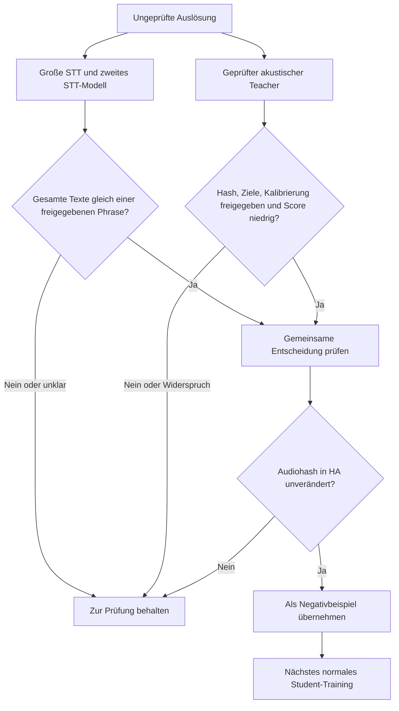

# Fehlaktivierungen direkt in Home Assistant prüfen

Der Collector bleibt die Oberfläche zum Anhören und Bestätigen. Der Trainer
holt ungeprüfte Auslösungen über die Home-Assistant-HTTP-Schnittstelle, führt
unabhängige Spracherkennung und optional Student-/Teacher-Bewertungen durch
und liefert die Ergebnisse an die Collector-Karte zurück. SSH, sudo und ein
Home-Assistant-Administratortoken werden für diesen Ablauf nicht benötigt.
**Ohne `negative_policy` ist die Prüfung lesend.** Eine ausdrücklich
konfigurierte Richtlinie kann dagegen Collector-Labels ändern. Diese
Schreibwirkung muss beim Einrichten des Profils bewusst freigegeben werden.

## Einrichtung

Beide öffentlichen Repositories aktualisieren: Wake Word Collector ab 0.5.5
über HACS, Wake Word Trainer ab 0.6.1 auf der Workstation. Nach dem HACS-Update
Home Assistant nach erfolgreicher Konfigurationsprüfung neu starten; die
Frontend-Seite neu laden. Die bisherige Trainer-Adresse und dessen Token in
den Collector-Optionen bleiben gültig. Der Trainer benötigt in `wakeword.yaml`
die Collector-Adresse und dessen vorhandene Token-Datei:

```yaml
collector:
  url: http://homeassistant.local:8123
  token_file: ~/.config/wake-word-trainer/collector.token
```

Auf der Workstation das `segment`-Extra für faster-whisper installieren. Wer
zusätzlich einen Teacher benutzt, benötigt das `teacher`-Extra und ein bereits
geprüftes portables Teacher-Modell. Bei ausdrücklich konfigurierten Profilen
folgendes zum privaten `service.yaml` hinzufügen und den Trainer-Dienst neu
starten, wenn kein Lauf aktiv ist:

```yaml
profiles:
  # Vorhandene Trainingsprofile ebenfalls behalten.
  review:
    label: Fehldetektionen prüfen
    kind: review
    days: 7
    limit: 500
    stt_model: medium
    threads: 4
    # device: bath                  # optional: Collector-Gerätekennung
    # teachers: [teacher/model.pt]  # optional, Pfad relativ zum Projekt
    # models: [deployed/model.tflite]
```

Ohne `models` bewertet der Trainer das vorhandene
`deployment.reference_model`, falls die Datei existiert. Ohne Teacher werden
STT und gegebenenfalls Student trotzdem ausgewertet. Profile können für Räume
und verschiedene Zeiträume vorkonfiguriert werden. Die Nachtplanung akzeptiert
nur Trainingsprofile, keine Prüfung und keinen Benchmark.

## Bedienung

In der Collector-Karte **Aufnahmen prüfen** starten. Der Knopf verwendet das
Profil `review`, andernfalls das erste konfigurierte Prüfprofil. Andere
Prüfprofile lassen sich über die bestehende Profilauswahl und den Startknopf
aufrufen. Fortschritt, Abschluss oder Fehler erscheinen am Trainingssensor.
Die Karte aktualisiert sich auch dann, wenn sich nur die Auswertung geändert
hat und keine neue Aufnahme hinzugekommen ist.

Zu jeder bewerteten Aufnahme zeigt sie den unabhängigen STT-Text, die größte
Student-/Teacher-Antwort und den Prüfvorschlag. **Negativkandidat** ist noch
kein bestätigter Fehlalarm. Anhören, dann **Fehlalarm** oder
**War das Aktivierungswort** wählen; unklare Aufnahmen stehen lassen. Eine
leere Transkription und ein niedriger Teacher-Score beweisen keinen Fehlalarm.
Die Scores unterschiedlicher Modelle sind nicht automatisch kalibriert.

Erst das Bestätigen im Collector oder die unten beschriebene ausdrücklich
aktivierte Negativfreigabe macht einen Clip zum Trainingsbeispiel.
Anschließend das normale GPU-Training starten und am gemeinsamen Prüfbestand
mit dem eingesetzten Modell vergleichen. Für jedes Gerät werden außerdem echte
positive Aufrufe vom selben Mikrofon benötigt: Beispiele anderer Räume
belegen dessen Erkennung nicht.

## Daten und Ressourcen

`days` filtert nach **Speicherzeit in Home Assistant**, nicht nach exakt
synchronisiertem Auslösezeitpunkt. Die neuesten passenden Clips kommen zuerst;
`limit` begrenzt den Bestand auf höchstens 2.000. `truncated: true` bedeutet,
dass passende Aufnahmen fehlen und der Zeitraum oder Gerätefilter enger
gewählt werden sollte. Es gibt keine automatische Pagination.

Jeder Lauf bekommt einen neuen privaten Ordner `review/run_…` mit WAV-Snapshot,
Prüfsummen, Herkunft und Auditbericht. Diese Dateien werden nicht in
`recordings/train` oder `recordings/eval` importiert. `review.json` enthält die
letzte Auswertung. Audio und Transkripte bleiben außerhalb von Git. Der
Snapshot-Ordner ist nur für den Besitzer zugänglich, WAVs und Berichte haben
Dateimodus 0600. Alte Snapshots bei Bedarf selbst löschen.

Bekannte Originalaufnahme-, Elternaufnahme-, Sitzungs-, Sprecher- und
Aufnahmegenerationsangaben bleiben im Bericht erhalten; fehlende Angaben
werden nicht aus Dateinamen oder Geräten erraten. Enthält ein Audiohash
mehrere Herkünfte, listet `origins` alle auf. Der Bericht wählt dann keinen
einzelnen Zielclip aus und blockiert die automatische Labeländerung. Das
belegt noch keine unabhängige Trennung von Trainings- und Prüfdaten; dafür
gilt weiterhin der gemeinsame Datensatzvertrag.

Das Standardprofil nutzt die CPU, begrenzt seine Threads und pausiert keine GPU-Dienste.
Sie kann bei einer anderweitig belegten GPU laufen; ein aktiver Lauf desselben
Trainer-Dienstes oder ein Firmware-Rollout blockiert einen zweiten Start.
RAM- und CPU-Prüfung bleiben wirksam. Das eigentliche Student-Training nutzt
weiter die konfigurierte GPU. Ein Prüfabschluss bietet kein altes oder neues
Modell an und löst keinen Rollout aus.

## HTTP-Schnittstellen

Der Collector akzeptiert für beide neuen GET-Routen ausschließlich seinen
vorhandenen `X-Wakeword-Token`. Die Routen ändern keine Labels:

| Route | Inhalt |
| --- | --- |
| `/api/wake_word_collector/export/<slug>/review` | `clips`, `labels_confirmed: false`, `total`, `truncated`; Filter `device`, `created_after` mit Zeitzone und `limit` |
| `/api/wake_word_collector/export/<slug>/review/<category>/<device>/<filename>` | WAV aus `triggers`, `needs_review` oder `rejected_transcript` |

Bestätigte Positive und Negative bleiben in den bisherigen getrennten
Trainings-Exporten. Der Trainer akzeptiert nur Audioverweise genau innerhalb
dieser Review-Route, prüft vorhandene SHA-256-Werte und folgt keinen HTTP-
Weiterleitungen mit dem Token. Nach einer Verschiebung oder Bearbeitung kann
ein Snapshot-Abruf fehlschlagen; dann einen neuen Prüfstart verwenden.

`GET /v1/review` am Trainer benötigt dessen vorhandenen Bearer-Token und
liefert den privaten Detailbericht. `/v1/status` enthält nur eine Zusammenfassung
unter `review` sowie `review_profiles`. Die Collector-Karte holt Detailtexte
über den angemeldeten WebSocket-Zugang; Transkripte werden nicht als neue
Sensorattribute an den Recorder gegeben. Prüfergebnisse werden anhand des
Audiohashes zugeordnet: Nach einem Schnitt passt ein altes Ergebnis nicht mehr.

Für einen gezielten lokalen Aufruf derselben HA-Schnittstelle:

```bash
wake-word-trainer -p my_project review --device bath \
  --since '2026-10-14T00:00:00+02:00' --stt-model medium \
  --teacher teacher/model.pt
```

Dieser Abruf benötigt ebenfalls nur den Collector-Token. Eine 404-Meldung
über eine fehlende Prüfschnittstelle bedeutet, dass der Collector zuerst
aktualisiert werden muss.

## Große STT auf GPU und begrenzte Negativfreigabe

Ab Trainer 0.6.2 kann `torch_whisper` große Whisper-Modelle auf CPU oder einer
geprüften PyTorch-GPU betreiben. ROCm-PyTorch verwendet ebenfalls die
Gerätekennung `cuda`; das bezeichnet dort den HIP-Pfad. Die Engine prüft eine
echte Operation und lehnt CPU-Fallback bei angeforderter GPU ab. `auto` als
Erkennungssprache hilft bei gemischten Geräteansagen und Gesprächen.

```yaml
profiles:
  review_high:
    label: Große STT und Teacher prüfen
    kind: review
    stt_backend: torch_whisper
    stt_device: gpu
    stt_model: large-v3
    stt_language: auto
    verification_model: medium
    stt_cache: models/stt
    teachers: [teacher/full_phrase.pt]
    days: 1
    threads: 4
```

Das zusätzliche Extra `stt` installiert Whisper. Zuerst passendes CUDA- oder
ROCm-PyTorch installieren und dessen Versionen mit Constraints erhalten.
GPU-Prüfprofile nutzen dieselbe gemeinsame Sperre und Pausendienste wie andere
GPU-Arbeit; CPU-Profile bleiben davon ausgenommen. Der Modellcache wird zwischen
Läufen geteilt. Zwei STT-Modelle liefern eine Gegenprüfung, keine mathematisch
unabhängigen Beweise für die Richtigkeit des Texts.

Für getrennte Framework-Umgebungen sind `worker_python` als absoluter Pfad,
`isolated_runtime: true` und `skip_student: true` möglich. Das Profil startet
nur den lokal konfigurierten Interpreter und entfernt geerbte GPU-Loader-
Variablen. STT und Teacher laufen dann ohne TensorFlow-Import. Der CPU-
Prüfweg mit Student-Scores bleibt separat verfügbar. Netzwerkanrufer können
keinen Interpreter oder freien Pfad vorgeben.



Eine private `negative_policy` ist ausdrücklich optional und standardmäßig
nicht gesetzt. Beide STT müssen nach derselben Wortnormalisierung den
**vollständigen gleichen Text** liefern, und dieser muss genau einer ganzen
freigegebenen Negativphrase entsprechen. Groß-/Kleinschreibung, Satzzeichen
und Wortabstände werden dabei normalisiert. Eine gemeinsame Teilphrase reicht
nicht: „start vacuuming please“ und „start vacuuming now“ bleiben unklar;
auch zwei identische Texte mit zusätzlichen Wörtern zur freigegebenen Phrase
werden nicht automatisch übernommen.

Alle Wörter beider vollständigen Texte benötigen gültige Konfidenzen.
Fehlende Werte, boolesche Werte, NaN, STT-Fehler und Widersprüche sperren
die Anwendung. Projekt-/TTS-Positive und positive Teacher-Zielphrasen haben
Vorrang vor einer Negativfreigabe, selbst wenn der Teacher einen niedrigen
Score liefert. Beispiel mit neutraler Geräteansage:

```yaml
known_negative_phrases: [start vacuuming]
allowed_teacher_hashes: ["<SHA-256 des geprüften Teachers>"]
teacher_calibrations:
  "<SHA-256 des geprüften Teachers>":
    target_phrases: [hey nova]
    evidence: private-reviews/teacher-validation.json
min_word_probability: 0.85
max_teacher_score: 0.1
```

Den Pfad unter dem Prüfprofil als `negative_policy` eintragen. Das ist keine
allgemeine automatische Umwandlung jeder Sprache ohne erkanntes Aktivierungswort.
Leere, unsichere oder widersprüchliche Erkennung bleibt offen. Teacher-Modelle
müssen vorher auf den passenden positiven Zielen und getrennten Negativen
bei der konfigurierten Scoregrenze geprüft sein. `evidence` verweist auf diesen
privaten, manuell geprüften Kalibrierbeleg; der Pfad wird nicht ausgeführt oder
automatisch als Qualitätsnachweis ausgewertet. Die normalisierten Zielphrasen
der Freigabe müssen denen im Teacher entsprechen und alle Projekt-/TTS-Ziele
abdecken. Fehlende oder abweichende Ziele und ein fehlender Kalibrierbeleg
bleiben unklar. Eine alte reine Hashallowlist erlaubt deshalb noch keine
automatische Labeländerung. Nach Modell- oder Zielwechsel die Freigabe erneut
prüfen. Ein niedriger Score eines unpassenden oder unkalibrierten Teachers
ist kein Negativbeweis.

Für diese Schreibwirkung muss der eingesetzte Collector die Negativentscheidung
per POST an der Audio-Review-Route unterstützen. Nur `triggers` sind erlaubt.
Vor Aktivierung die Collector-Implementierung gemeinsam prüfen: unveränderter
Audiohash muss serverseitig atomar mit der Labeländerung validiert werden,
geänderte oder bereits bewertete Clips müssen abgewiesen und Entscheidungen
nachvollziehbar dokumentiert werden. Eine Versionsnummer allein belegt diesen
Vertrag nicht.

Der Trainer folgt auch beim POST keinem Redirect und liest wie beim GET
höchstens 8 MiB JSON-Antwort. Nur eine passende Bestätigung mit Kategorie
`negatives` und dem unveränderten SHA-256 gilt als übernommen. Bei einer zu
großen, ungültigen oder widersprüchlichen Antwort wird kein Erfolg gemeldet.
Ein Antwortfehler nach dem POST beweist jedoch nicht, dass der Collector noch
nichts geändert hat; vor einer Wiederholung dessen Stand abgleichen.
`labels_changed` zählt tatsächlich übernommene Clips; Fehler bleiben sichtbar.
Eine Labelübernahme startet weder Training noch Firmware-Rollout automatisch.

Grundlagen: [Whisper](https://github.com/openai/whisper) und
[PyTorch-HIP-Semantik](https://docs.pytorch.org/docs/stable/notes/hip.html).
