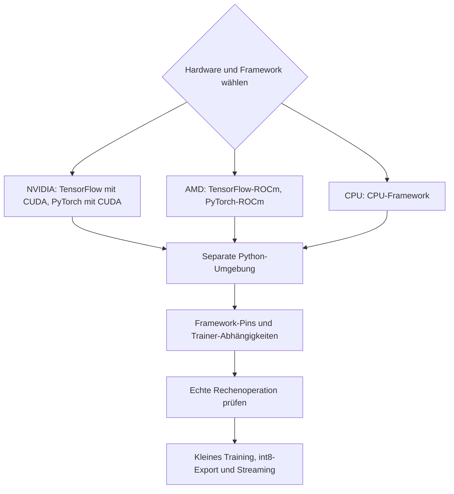

# Installation

Linux und Python 3.10–3.12 sind der übliche Trainingsweg. CPU ist möglich;
für umfangreiche Student- oder Teacher-Läufe eine GPU verwenden. Vor der
Installation passende Treiber-, GPU-, Python- und Framework-Versionen prüfen.
Die öffentliche Anwendung unterstützt NVIDIA/CUDA und AMD/ROCm; die tatsächlich
verfügbare Hardware bestimmt, welcher Nachweis lokal erbracht werden kann.



## NVIDIA/CUDA

Eine kompatible NVIDIA-Treiberinstallation voraussetzen. TensorFlow bietet
unter Linux die CUDA-Abhängigkeiten über `and-cuda`; siehe die
[offizielle Installation](https://www.tensorflow.org/install/pip).
Ein zum getesteten Trainingsbackend passender 2.20-Aufbau ist beispielsweise:

```bash
python3 -m venv .venv
. .venv/bin/activate
pip install 'tensorflow[and-cuda]==2.20.*' 'numpy==1.26.4'
pip install 'wake-word-trainer[train,tts] @ git+https://github.com/ChristophBellmann/wake-word-trainer'
```

Für den optionalen Teacher passendes CUDA-PyTorch nach dessen offizieller
[Installationsauswahl](https://pytorch.org/get-started/locally/) installieren.
Kein ROCm-Wheel in diese Umgebung mischen. Der automatische ROCm-Loader
ändert eine CUDA-Framework-Umgebung nicht allein deshalb, weil `/opt/rocm`
auf dem Rechner vorhanden ist.

## AMD/ROCm

Die [AMD-Kompatibilitätsmatrix](https://rocm.docs.amd.com/en/latest/compatibility/compatibility-matrix.html)
und die [Radeon-Matrix](https://rocm.docs.amd.com/projects/radeon-ryzen/en/latest/docs/compatibility/compatibilityrad/native_linux/native_linux_compatibility.html)
unterscheiden GPU-, Betriebssystem- und Framework-Unterstützung. Ein neuer
SDK-Stand allein belegt noch kein passendes TensorFlow-Wheel.

Zuerst das zur Hardware und Runtime passende ROCm-TensorFlow-Wheel installieren.
Anschließend verhindern Constraints, dass pip das geprüfte Framework ersetzt:

```bash
python3 -m venv .venv
. .venv/bin/activate
pip install /path/to/tensorflow_rocm.whl 'numpy==1.26.4'
python - <<'PYTHON'
from importlib.metadata import PackageNotFoundError, version
from pathlib import Path
pins = []
for name in ('tensorflow', 'tensorflow-rocm', 'numpy', 'protobuf'):
    try:
        pins.append(f'{name}=={version(name)}\n')
    except PackageNotFoundError:
        pass
Path('keep.txt').write_text(''.join(pins))
PYTHON
pip install --no-deps 'microwakeword @ git+https://github.com/ChristophBellmann/micro-wake-word@664a767db4474cd149d2d54038ab9144808951ef'
python - <<'PYTHON'
from importlib.metadata import requires
from packaging.requirements import Requirement
import subprocess, sys
deps = [r for r in requires('microwakeword')
        if Requirement(r).name.lower().replace('_', '-') != 'tensorflow']
subprocess.check_call([sys.executable, '-m', 'pip', 'install', '-c', 'keep.txt', *deps])
PYTHON
pip install -c keep.txt tensorboard 'wake-word-trainer[tts] @ git+https://github.com/ChristophBellmann/wake-word-trainer'
```

`tensorflow-rocm` stellt das Modul `tensorflow` bereit, erfüllt aber nicht
pip-Abhängigkeiten mit dem Distributionsnamen `tensorflow`. Deshalb wird
microWakeWord zuerst ohne Abhängigkeitsauflösung installiert und anschließend
der übrige Bestand ergänzt. Kein zweites TensorFlow installieren, nur um eine
solche `pip check`-Warnung zu beseitigen. Import und echte GPU-Operation prüfen.

Für PyTorch eine passende AMD-Fassung wählen. Ein selbständiger Python-SDK darf
keine Bibliotheken einer anderen systemweiten ROCm-Version zugemischt bekommen.
Ein ausdrücklich gesetzter `ROCM_PATH` ist eine bewusste lokale Auswahl.

## Extras und Prüfung

| Extra | Zweck |
| --- | --- |
| `train` | microWakeWord und Student-Training |
| `tts` | Piper-ONNX-Spracherzeugung auf CPU |
| `segment` | faster-whisper für lokale STT und Extraktion |
| `teacher` | PyTorch für den optionalen Teacher |
| `dev` | pytest und Ruff |

microWakeWord ist auf einen festen Fork-Commit mit Paket-, NumPy- und
Exportkorrekturen gebunden. Die jeweilige geprüfte Framework-Fassung bleibt
in privaten Constraints festgehalten.

```bash
wake-word-trainer --version
python - <<'PYTHON'
import tensorflow as tf
print(tf.config.list_physical_devices('GPU'))
with tf.device('/GPU:0'):
    result = tf.matmul(tf.ones((16, 16)), tf.ones((16, 16)))
print(result.device, float(tf.reduce_sum(result).numpy()))
PYTHON
```

Zusätzlich `training.device: gpu` setzen: Die Anwendung bricht bei fehlender
GPU oder CPU-Fallback des Prüfoperators ab. Danach kleines Training,
Checkpoint, int8-Export und Streaming-Inferenz prüfen. Die Geräteauflistung
allein genügt nicht. [Runtime-Umzug](rocm-update.md) beschreibt den Austausch
bereits angepasster Wheels und den Rückweg.
