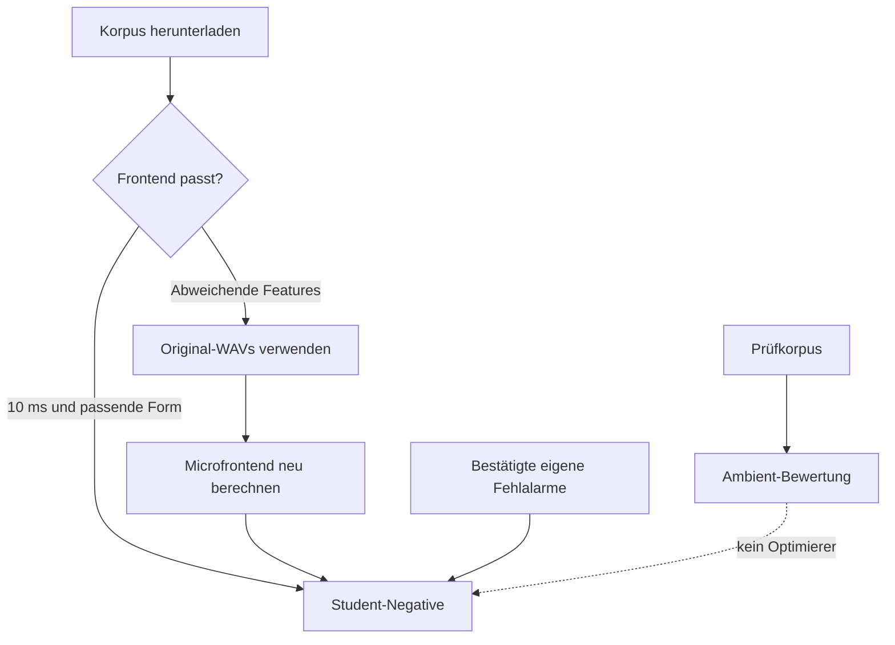

# Negativkorpora: Auswahl und Qualitätsvergleich

Der Student verwendet standardmäßig die vorgefertigten Microfrontend-Quellen
`speech`, `dinner_party` und `no_speech`. `dinner_party_eval` bleibt ausschließlich
Ambient für Validierung und Prüfung mit Sampling-Gewicht null. Eigene
bestätigte Fehlaktivierungen und externe WAV-Sprache haben eigene Anteile.

## Quellen und Feature-Kompatibilität

Die [Hugging-Face-Quellenbeschreibung](https://huggingface.co/datasets/kahrendt/microwakeword/blob/main/README.md)
dokumentiert die Audioherkunft und die Frontend-Fassungen. Einige Background-
Archive verwenden 20-ms-Schritte; der aktuelle Student und ESPHome benötigen
10-ms-Features. Diese Archive sind herunterladbar, aber nicht unverändert für
das aktuelle Student-Training auswählbar. Aus den Original-WAVs passende
Features neu erzeugen; Float-Casts oder Frame-Verdopplung ersetzen das nicht.

| Quelle | Rolle | Standardgewicht |
| --- | --- | ---: |
| `speech` | negative Sprache | 10 |
| `dinner_party` | negative Gespräche | 10 |
| `no_speech` | andere Negativgeräusche | 5 |
| `dinner_party_eval` | Ambient-Holdout | 0 |
| `speech_background`, `dinner_party_background`, `no_speech_background` | abweichende 20-ms-Archive; aktuelle Auswahl wird abgelehnt | — |



MMAP-Einträge sind Ausschnitte, keine unabhängigen Sprecher oder Gespräche.
Überlappende Quellaufnahmen und verschiedene Frontend-Fassungen dürfen nicht
als unabhängige Datenmenge addiert werden. Ein Korpus mit mehr als einer Million
Einträgen kann nützlich sein; Sampling, Leakage und Ergebnis sind entscheidend.
Diese MMAPs gehören nicht in den Log-Mel-Teacher, der WAVs benötigt.

## Download und Auswahl

```bash
wake-word-trainer -p my_project --downloads shared_downloads download \
  --negative-set speech --negative-set dinner_party \
  --negative-set no_speech --negative-set dinner_party_eval
```

```yaml
negatives:
  feature_sets: [speech, dinner_party, no_speech, dinner_party_eval]
training:
  weights:
    speech: 10
    dinner_party: 10
    no_speech: 5
    satellite_negative: 4
```

Die Gewichte bestimmen Quellanteile, nicht die Zahl geladener Dateien.
Eigene Satelliten-Negative dürfen durch größere öffentliche Korpora nicht
praktisch verschwinden. Speichermapping lädt den Bestand nicht vollständig
in den RAM; Zuführung und Cache müssen trotzdem begrenzt werden.

## Verbessert ein Korpus das Modell?

Mit eingefrorenen Aufnahmen mindestens zwei Seeds vergleichen:

1. Standardkorpora mit bisherigen Sampling-Anteilen.
2. Korpus entfernt: verändert auch die normalisierte Verteilung.
3. Gleiche Sampling-Masse durch andere negative WAV-Quellen ersetzt.

Prüfclips und Ambient-Stunden bleiben identisch und außerhalb des Trainings.
Erkennungsrate, eigene Negativfehler, Satelliten-Negativfehler und Ambient-
Fehler pro Stunde gemeinsam bewerten. Ein schnellerer Trainingsloop oder
weniger Fehler bei zugleich schlechterer Erkennung ist kein Erfolg.

Der TFRecord-Pool ist eine endliche Auswahl aus diesen Quellen. Eine Million
Pool-Beispiele kostet mehr Datenträger, Bauzeit und Shuffle-Speicher. Pool-
Größe getrennt bei denselben Seeds vergleichen; aus dem Durchsatz darf keine
Qualitätsverbesserung abgeleitet werden. Ein größerer Bestand wird nur nach
bestandener Regression aktiviert.

[GPU-Benchmarks](gpu-training-and-benchmarks.md),
[Datenübernahme](data-import.md) und [Bewertung](evaluation.md) erklären die
entsprechenden Prüfungen. Individuelle Modellversuche und Stimmdaten bleiben
in privaten Projektberichten.
