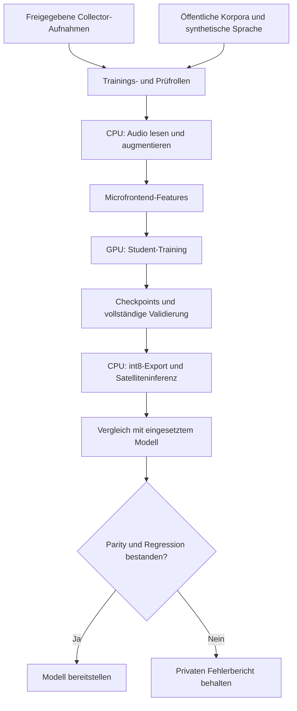

# Trainingsablauf

`run` führt die Schritte nacheinander aus. Jeder Schritt lässt sich für
Diagnosen auch einzeln aufrufen:

| Schritt | Befehl | Ergebnis |
| --- | --- | --- |
| Daten herunterladen | `download` | Sprache, Hintergrund, Raumantworten, negative Features und gewählte Piper-Stimmen |
| Eigene Aufnahmen holen | `fetch` | freigegebene WAVs mit stabiler Train-/Prüfaufteilung |
| Sprache erzeugen | `generate` | positive und ähnliche negative TTS-Clips |
| Features bauen | `features` | augmentierte Microfrontend-MMAPs |
| Trainieren | `train` | Student-Checkpoints und Trainingsmetriken |
| Bewerten | `evaluate` | Erkennung, Fehlaktivierungen, quantisierte Schwellenkurve |
| Exportieren | `export` | TFLite-Modell und ESPHome-Manifest |

Die Trainingsdaten werden über Quellgewichte ausgewählt. Vollständige
Prüfaufnahmen und Ambient-Stunden bleiben außerhalb des Optimierers.
Checkpoints werden anhand der Validierung gewählt, eine abschließende Prüfung
benötigt zusätzliche unabhängige Aufnahmen.

`run --prepare-only` bereitet nur Daten und Features vor. `run --resume` setzt
einen unterbrochenen Ablauf fort; `--force` erneuert die Vorbereitung.
Bei Mining-Runden kommen schwierige negative Trainingsfenster hinzu, danach
folgt erneut die vollständige Bewertung. Mining darf keinen Prüfbestand lesen.

Die gemeinsame GPU-Belegung gilt während eines vollständigen Laufs auch für
CPU-/I/O-Phasen. So können andere GPU-Arbeiten nicht zwischen zwei Phasen die
Runtime übernehmen. Reine Datenvorbereitung und die unabhängige Clip-Prüfung
benötigen diese Belegung nicht.

[Datenprüfung](data-audit.md), [GPU-Benchmarks](gpu-training-and-benchmarks.md)
und [Bewertung](evaluation.md) erklären die Nachweise hinter den Schritten.
