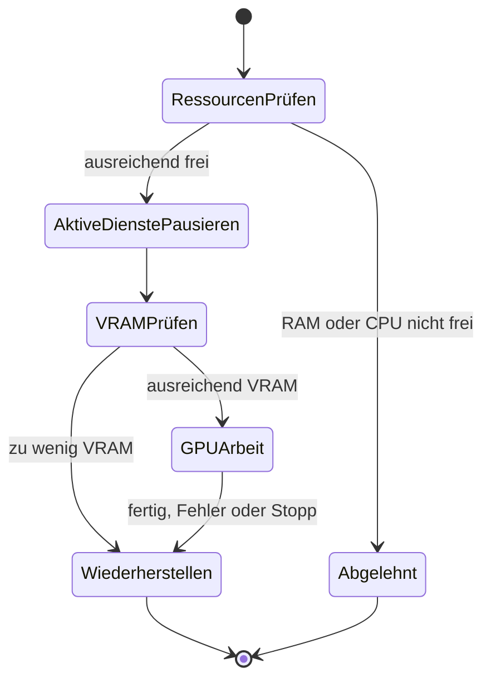

# GPU teilen und Ressourcen prüfen

Der Trainingsrechner kann auch Sprachmodelle oder GPU-Sprachausgabe betreiben.
Im privaten `service.yaml` deren systemd-User-Dienste eintragen:

```yaml
pause_services:
  - llama-server.service
  - orpheus-llm.service
  - wyoming-orpheus.service
```

Vor einem GPU-Lauf pausiert der Trainer nur Dienste, die aktiv waren. Nach
Abschluss, Fehler, Stopp oder regulärem Dienstende startet er genau diese
wieder. Inaktive Dienste bleiben inaktiv. `paused_services.json` ermöglicht
die Wiederherstellung nach einem unterbrochenen Lauf. Die Namen sind Beispiele;
ohne diese Einstellung wird kein anderer Dienst verwaltet. Direkte CLI-Läufe
verwalten diese Dienste nicht.



## Grenzwerte

```yaml
resource_check:
  min_available_memory_gb: 6
  max_load_per_cpu: 0.75
  min_free_vram_gb: 8
  wait_seconds: 10
```

RAM und CPU werden vor dem Start geprüft, GPU-RAM nach dem Pausieren. Ein
abgelehnter Start lässt den letzten Lauf unverändert und liefert HTTP 503 mit
Grund. Reicht der GPU-RAM anschließend nicht, werden pausierte Dienste sofort
wiederhergestellt. Während eines Laufs prüft der Dienst alle 30 Sekunden den
RAM und zeigt eine Warnung unter `resources`; diese Warnung beendet den Lauf
nicht. `enabled: false` deaktiviert die Ressourcenprüfung.

Die gemeinsame Dateisperre verhindert gleichzeitige Student-, Teacher- und
Benchmark-Arbeit. Eine verwaiste Sperrdatei allein blockiert nicht; entscheidend
ist die aktive Betriebssystem-Sperre. CPU-Prüfprofile pausieren keine GPU-Dienste.
Untergeordnete Aufrufe innerhalb derselben aktiven Lease, desselben Prozesses,
Threads und asyncio-Tasks verwenden die äußere Belegung. So können GPU-STT und
Teacherinitialisierung/-bewertung gemeinsam laufen, ohne eine zweite Belegung
anzufordern. Nur der äußere Kontext schreibt Belegungsmetadaten und gibt die
Sperre frei, auch bei Exceptions. Andere Threads, Tasks und Prozesse müssen
weiterhin eine eigene Betriebssystem-Sperre erhalten; `busy()` bleibt auch im
besitzenden Kontext wahr. Ein Fork erbt keine implizite Reuse-Berechtigung.
Die bestehende explizite FD-Übergabe an Trainingsworker bleibt davon getrennt;
der Elternprozess verwaltet dabei die Belegung bis zum Workerende.
Die Datenprüfung validiert STT-Backend, Gerät und eine ganzzahlige Threadzahl
von 1 bis 32 vor der Modellinitialisierung. Teacher erhalten dasselbe explizite
Gerät und dieselbe Threadzahl: CPU-Prüfungen verwenden auch für Teacher CPU,
GPU-Prüfungen fordern ausdrücklich GPU an. Ein automatischer Teacher-Gerätewechsel
findet in diesem Pfad nicht statt.

## Quelle und Laufzeit der Controller-Worker

`worker_python` in einem lokalen Prüfprofil muss einen vorhandenen absoluten
Interpreterpfad bezeichnen. HTTP-Aufrufe wählen nur eine Profilkennung und
können weder Interpreter noch Trainerquelle ändern. Der Controller bindet
seine Worker an das eigene Paketverzeichnis und ein beim Controllerstart
erfasstes SHA256-Manifest aller Pythonquelldateien. Nach Quelländerungen ist
ein Controllerneustart erforderlich. Eine Paketversionsnummer allein reicht
für diese Bindung nicht aus.

Der Worker startet mit isolierter Pythonauflösung (`-I -S`), prüft das gesamte
Quellmanifest vor Trainer- oder Frameworkimports und lädt Trainermodule aus
den geprüften Quelldateien. Alte Installationen und Bytecode-Caches ersetzen
diese Quelle nicht; auch einzelne später importierte Dateien werden vor dem
Kompilieren erneut geprüft. Fehlende oder abweichende Bindungen brechen den
Workerstart ab. Die Bindung bleibt beim GPU-Loader-Neustart erhalten. Die
Paketquelle muss während eines Laufs unverändert bleiben; das Manifest ersetzt
keine Betriebssystem-Zugriffskontrolle für lokale Installationen.

Alle geerbten `PYTHON*`-Loaderparameter werden entfernt; insbesondere beeinflussen
`PYTHONPATH` und `PYTHONHOME` die Quellwahl nicht. Erst nach der Quellprüfung werden
die Abhängigkeiten der gewählten Interpreterinstallation über `site` verfügbar.
Die GPU-Umgebung bleibt über den bestehenden Runtimevertrag gesteuert:
`isolated_runtime` entfernt die vorgesehenen ROCm-/HIP-/dynamischen Loaderwerte;
ohne diese Option bleibt die vorbereitete GPU-Umgebung erhalten. CPU-Prüfprofile
verbergen zusätzlich die GPU-Geräte.

[GPU-Benchmarks](gpu-training-and-benchmarks.md) unterscheiden Zuführung,
Rechendurchsatz und Modellqualität.
