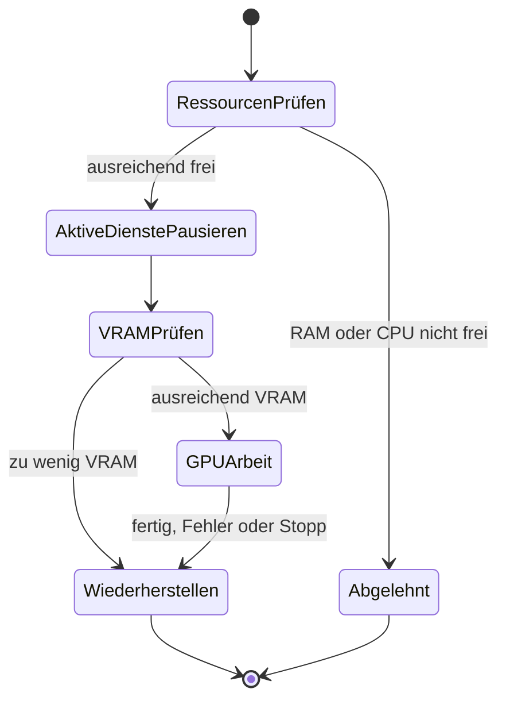

# GPU teilen und Ressourcen prüfen

Der Trainingsrechner kann auch Sprachmodelle oder GPU-Sprachausgabe betreiben.
Im privaten `service.yaml` deren systemd-User-Dienste eintragen:

```yaml
pause_services:
  - llama-server.service
  - orpheus-llm.service
  - wyoming-orpheus.service
```

Vor einem GPU-Lauf pausiert der Trainer nur Dienste, die aktiv waren. Nach
Abschluss, Fehler, Stopp oder regulärem Dienstende startet er genau diese
wieder. Inaktive Dienste bleiben inaktiv. `paused_services.json` ermöglicht
die Wiederherstellung nach einem unterbrochenen Lauf. Die Namen sind Beispiele;
ohne diese Einstellung wird kein anderer Dienst verwaltet. Direkte CLI-Läufe
verwalten diese Dienste nicht.



## Grenzwerte

```yaml
resource_check:
  min_available_memory_gb: 6
  max_load_per_cpu: 0.75
  min_free_vram_gb: 8
  wait_seconds: 10
```

RAM und CPU werden vor dem Start geprüft, GPU-RAM nach dem Pausieren. Ein
abgelehnter Start lässt den letzten Lauf unverändert und liefert HTTP 503 mit
Grund. Reicht der GPU-RAM anschließend nicht, werden pausierte Dienste sofort
wiederhergestellt. Während eines Laufs prüft der Dienst alle 30 Sekunden den
RAM und zeigt eine Warnung unter `resources`; diese Warnung beendet den Lauf
nicht. `enabled: false` deaktiviert die Ressourcenprüfung.

Die gemeinsame Dateisperre verhindert gleichzeitige Student-, Teacher- und
Benchmark-Arbeit. Eine verwaiste Sperrdatei allein blockiert nicht; entscheidend
ist die aktive Betriebssystem-Sperre. CPU-Prüfprofile pausieren keine GPU-Dienste.
[GPU-Benchmarks](gpu-training-and-benchmarks.md) unterscheiden Zuführung,
Rechendurchsatz und Modellqualität.
