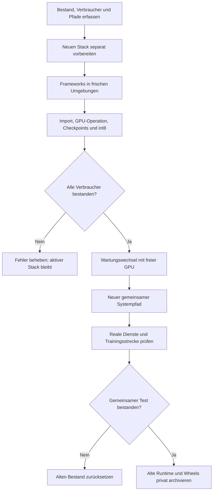

# ROCm-/CUDA-Stack aktualisieren und umziehen

Treiber, native Runtime, Compiler, Framework-Wheels und Python-Umgebungen
müssen gemeinsam passen. Eine funktionierende SDK-Installation ersetzt keinen
Teacher-/Student-Nachweis. Ein individuell gebautes altes Wheel wird bei einem
Stack-Wechsel durch eine passende geprüfte Fassung ersetzt.

## Vorbereitung

Paketversionen, Wheel-Hashes, Compiler, Linker, GPU-Zielarchitektur und reale
Bibliothekspfade erfassen. Shell, systemd-Umgebung, `/etc/profile.d`, `PATH`,
`ROCM_PATH`, Loader-Konfiguration und symbolische Links gehören zum Bestand.
Ein Compiler im Shell-Pfad kann bewusst ausgewählt sein; dessen Funktion
prüfen, bevor ein Link entfernt wird.

Neue Runtime versioniert neben dem aktiven Bestand ablegen. Python-Umgebungen
neu erstellen und passende Wheels installieren; eine bestehende angepasste
Umgebung nicht blind aktualisieren. NVIDIA/CUDA und AMD/ROCm bleiben getrennte
Framework-Installationen mit demselben öffentlichen Anwendungscode.

## Nachweise

Für jede GPU-Umgebung tatsächliche Operatoren und verwendete Bibliotheken
prüfen. Student: Training, Checkpoint-Laden, int8-Konvertierung und Streaming.
Teacher: GPU-Training/-Scoring und Vergleich mit CPU-Logits. Andere Verbraucher,
beispielsweise GPU-TTS oder Sprachmodelle, benötigen ihre eigenen Prüfungen.
Framework-Import und Geräteanzeige reichen nicht.

Benchmarks mit identischem Audio bzw. Features, Seeds, Aufwärmen und mehreren
Wiederholungen durchführen. Kein laufendes Gespräch für einen Benchmark
unterbrechen. [Compiler und Softwarestack](software-stack-and-compiler.md)
erklärt Host-/GPU-Trennung und Fehler bei indirekten Bibliothekspfaden.

## Umschaltung und Archiv

Mit freier gemeinsamer GPU-Sperre und abgeschlossenen Dienstarbeiten wechseln.
`/opt/rocm` kann auf einen versionierten Bestand eines ausreichend großen
Datenträgers zeigen. Shell und systemd danach in frischen Prozessen prüfen;
ein alter Prozess kann bereits geladene Bibliotheken behalten.

Alte Runtime, individuell gebaute Wheels und alte GPU-Umgebungen mit einem
Manifest in einen privaten temporären Archivordner des Datenträgers verschieben.
Originalpfad, Zielpfad, Hash und zugehörige Verbraucher festhalten. Bewegte
Python-Umgebungen sind wegen absoluter Interpreterpfade nicht als aktive
Umgebungen verwendbar; für einen Rückweg den ursprünglichen Pfad herstellen.
Den alten Bestand erst nach bestandenem gemeinsamen Diensttest archivieren.
Sprachdaten und Trainingsdatensätze gehören nicht zum Runtime-Archiv.

Die [AMD-Installation](https://rocm.docs.amd.com/en/latest/install/rocm.html)
und [TensorFlow-CUDA-Installation](https://www.tensorflow.org/install/pip)
sind die primären Grundlagen; die konkrete Versionsauswahl und private
Installationshistorie bleiben im lokalen Betriebsnachweis.
