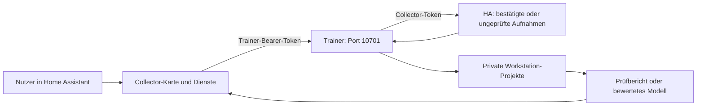

# Trainer-Dienst für Home Assistant

`wake-word-trainer serve` läuft auf dem Trainingsrechner. Der öffentliche
[Wake Word Collector](https://github.com/ChristophBellmann/ha-wake-word-collector)
zeigt Status, startet und stoppt vorkonfigurierte Profile, prüft Aufnahmen und
übernimmt nach erfolgreicher Bewertung ein exportiertes Modell.



## Einrichtung

[`deploy/service.example.yaml`](https://github.com/ChristophBellmann/wake-word-trainer/blob/main/deploy/service.example.yaml)
als `~/.config/wake-word-trainer/service.yaml` übernehmen und privat anpassen.
Ein eigener Trainer-Token wird getrennt vom Collector-Token angelegt:

```bash
mkdir -p ~/.config/wake-word-trainer
(umask 077; openssl rand -hex 24 > ~/.config/wake-word-trainer/service.token)
```

```yaml
project: ~/wakeword/my_project
downloads: ~/wakeword/downloads
token_file: ~/.config/wake-word-trainer/service.token
bind: 0.0.0.0
port: 10701
profiles:
  quick: {label: Kurz, rounds: 0, steps: 10000}
  recommended: {label: Empfohlen, rounds: 2}
  thorough: {label: Ausführlich, rounds: 4, steps: 40000}
  validate: {label: Nur Daten vorbereiten, prepare_only: true}
  review: {label: Fehldetektionen prüfen, kind: review, days: 7, stt_model: medium, threads: 4}
speaker_test:
  routes:
    speakers: [paplay, "{file}"]
    usb: [aplay, -D, "plughw:2,0", "{file}"]
```

Netzwerkaufrufer wählen ausschließlich konfigurierte Profile und
Lautsprecherrouten. Befehle, Dateipfade und freie Einstellungen können nicht
über die API übergeben werden. Dienste zum Freigeben von GPU-RAM und
Ressourcengrenzen werden ebenfalls nur lokal konfiguriert.

## systemd-User-Dienst

```bash
mkdir -p ~/.config/systemd/user
cp deploy/wake-word-trainer.service ~/.config/systemd/user/
systemctl --user daemon-reload
systemctl --user enable --now wake-word-trainer
loginctl enable-linger "$USER"
```

Die Unit erwartet `%h/wake-word-trainer/.venv/bin/wake-word-trainer`; den Pfad
an die eigene geprüfte Umgebung anpassen. ROCm- und NVIDIA-Umgebungen haben
jeweils passende Framework-Wheels; der Dienst verwendet dieselbe Umgebung
wie ein erfolgreich geprüfter lokaler Trainingslauf.

In den Collector-Optionen `http://<trainingsrechner>:10701` und den Trainer-
Token eintragen. Ist die Workstation ausgeschaltet, erscheint sie als nicht
erreichbar; die Aufnahmen bleiben in HA erhalten.

[HA-Prüfung](home-assistant-review.md), [Ressourcen](resources.md),
[Nachttraining](automatic-training.md), [Lautsprechertest und Rollout](deployment.md)
und [HTTP-API](api.md) beschreiben die einzelnen Abläufe.
