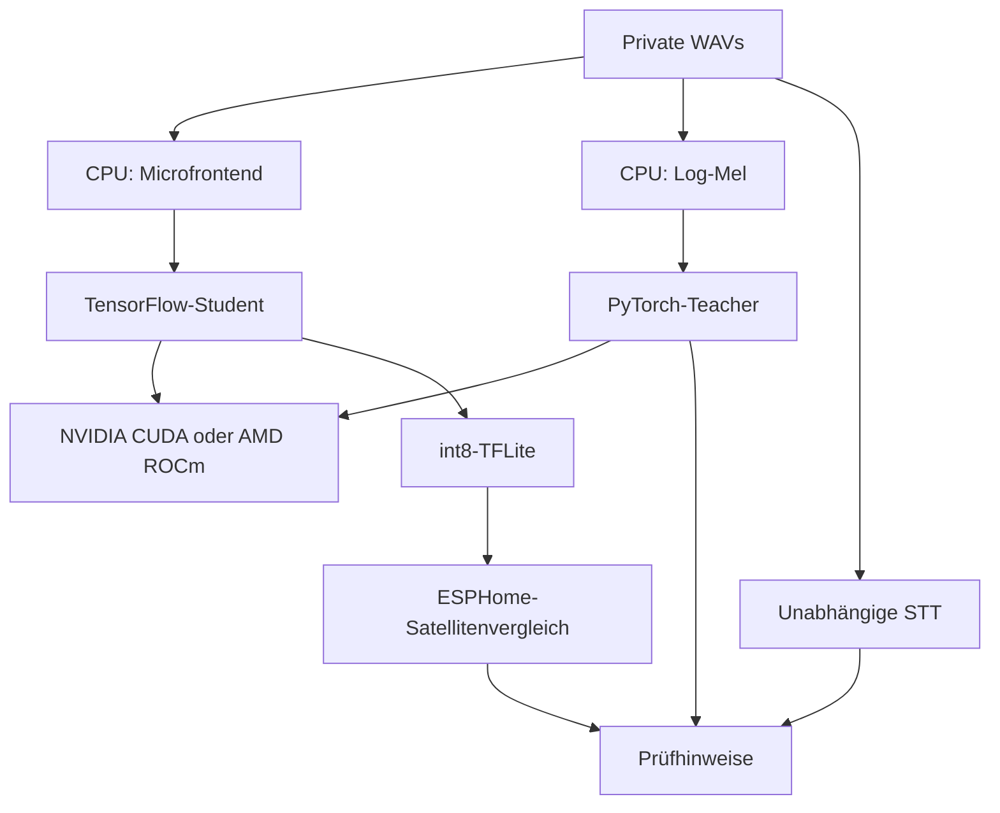
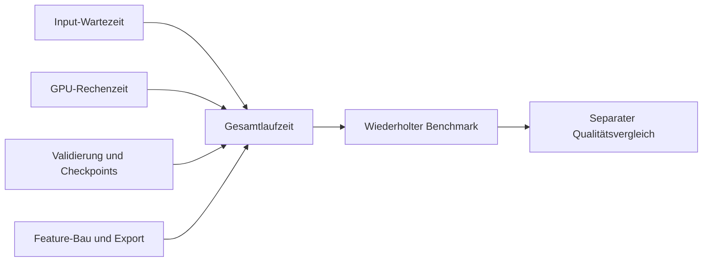

# Softwarestack, Compiler und Optimierung

Die Anwendung verwendet mehrere unabhängige Rechenwege. Deren Grenzen erklären,
wann CPU-Arbeit normal ist und wann die GPU tatsächlich trainieren muss.

| Baustein | Aufgabe | Ausführung |
| --- | --- | --- |
| Piper und ONNX Runtime | synthetische positive und negative Sprache | CPU |
| Audio-Augmentierung und Microfrontend | Student-Features passend zu ESPHome | CPU, mehrere unabhängige Worker |
| microWakeWord und TensorFlow | Student und Optimierer | NVIDIA/CUDA oder AMD/ROCm |
| PyTorch und Log-Mel-Teacher | zusätzliche akustische Prüfstimme | CPU oder NVIDIA/CUDA bzw. AMD/ROCm |
| STT | unabhängige Texte und Wortzeiten | abhängig von Engine CPU oder passende GPU |
| TFLite-Inferenz | quantisiertes Satellitenmodell vergleichen | CPU |
| Bazel, Host-Clang, GPU-Compiler und Linker | Framework-Wheels bauen | Kompilierung auf CPU, erzeugte Kernels später auf GPU |

## Host- und GPU-Compiler

Host-Clang baut C++-Code und die Werkzeuge, die während des Builds selbst
laufen. Der passende CUDA-/HIP-Compiler erzeugt GPU-Code für die Zielhardware.
Compiler-Versionen müssen mit dem Framework-Quellstand und SDK zusammenpassen;
beide Rollen ausdrücklich protokollieren. Ein neuer GPU-Compiler allein ist
kein Beweis für ein kompatibles TensorFlow- oder PyTorch-Wheel.

`-O3` optimiert Hostcode. LLD kann Linkerzeit und Speicherbedarf verbessern.
GPU-Zielarchitekturen begrenzen unnötige Kernelvarianten. Mehr Build-Jobs nutzen
mehr CPU, erhöhen aber RAM-Bedarf; Jobs, lokale CPU-Ressourcen und RAM-Grenze
gemeinsam wählen. Serielle Linker- und Generatorphasen können die Auslastung
auch bei vielen Jobs begrenzen. Tatsächliche CPU-Zeit messen.

Bazel-Caches hängen an Konfiguration, Quellen und Action-Umgebung. Eine globale
Loader-Umgebungsänderung kann sämtliche bisherigen Kompilate entwerten.
Probleme eines einzelnen Codegenerators deshalb möglichst an dessen Aktion
beheben und das Ziel separat prüfen, bevor der große Build fortgesetzt wird.

## Bibliothekssuchpfade

Ein Generator kann indirekt LLVM-Bibliotheken über COMGR laden. Relative
RUNPATHs können durch Bazels `_solib`-Symlinks ihren erwarteten Ausgangspunkt
verlieren. Zusätzlicher Executable-RPATH reicht dann nicht zwingend. Reale
Symlink-Ziele, `readelf -d`, Loader-Diagnose und tatsächlich geladene Dateien
vergleichen. Für einen solchen Generator einen passenden SDK-Loader-Pfad nur
an seiner Aktion setzen. Keine Bibliotheken verschiedener SDK-Stände mischen.

Ein Architektur-Override ist keine allgemeine Lösung für fehlenden Support.
Die tatsächliche GPU-Zielarchitektur, kompatible Bibliotheken und reale
Operatoren gemeinsam prüfen. Auf CUDA-Systemen darf ein vorhandener ROCm-
Ordner keine automatische ROCm-Injektion verursachen.

## Trainingskern und Zuführung

Ein kompilierter Graph vermeidet Python-Arbeit pro Batch, muss aber den
gewichteten Loss, Adam-Momente und Parameterupdates des Referenzwegs erhalten.
TFRecords, Prefetch und statische Validierungscaches haben Grenzen für RAM und
Datenträger. Zeit-/Frequenzmasken bleiben dynamisch pro Batch.

`steps/s` misst Schritte, `examples/s` berücksichtigt die Batchgröße. Input-
Wartezeit und Rechenzeit getrennt erfassen; Checkpoints, Validierung und Export
kommen als zusätzliche Zeit hinzu. GPU-Auslastung allein sagt weder, dass
alles effizient ist, noch, dass die Modellqualität besser wurde.

## Datentypen und Frontends

Student-Microfrontend und Teacher-Log-Mel sind unterschiedliche Merkmalsräume.
Unskalierte uint16-MMAPs benötigen ihre richtige Inferenzskalierung; skalierte
Float-Features dürfen nicht doppelt skaliert werden. Der quantisierte Student
wird mit exakten 8-Bit-Fenstersummen geprüft. Starke STT ergänzt diese Modelle,
ist aber ein eigenes Modell mit eigener Fehlerrate und eigener Spracheinstellung.

## Freigabe eines neuen Softwarestands

Wheel-Hash, Quellstand, Compiler, SDK und Abhängigkeiten festhalten. Frischer
Import muss sauber enden; danach echte GPU-Operation, Training, Checkpoint,
Export und Streaming prüfen. Teacher und andere Verbraucher benötigen eigene
Tests. Schließlich gemeinsame Dienste in der Zielumgebung prüfen, bevor der
alte Bestand archiviert wird. [Runtime-Umzug](rocm-update.md),
[GPU-Benchmarks](gpu-training-and-benchmarks.md) und
[Modellbewertung](evaluation.md) behandeln diese getrennten Freigaben.

Grundlagen: [TensorFlow-Quellbuild](https://www.tensorflow.org/install/source),
[Clang](https://clang.llvm.org/docs/UsersManual.html),
[Bazel](https://bazel.build/reference/command-line-reference),
[AMD-Kompatibilität](https://rocm.docs.amd.com/en/latest/compatibility/compatibility-matrix.html).
